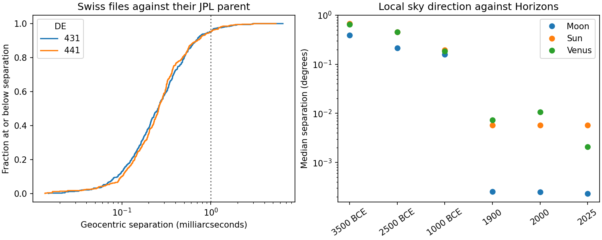
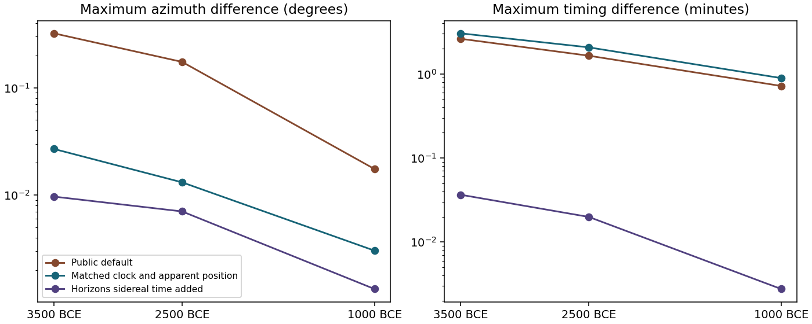

# A02 · Ephemeris accuracy and lunar skyline crossings {#a02-ephemeris-accuracy}

**Research question.** How closely do skyscapeR’s planetary and lunar positions reproduce their reference ephemerides, and how much does the choice of convention change a prehistoric lunar alignment?

**Outcome.** In build 2.0.9004 the largest geocentric angular separation from the matching JPL parent was **0.0065″** across 1,080 positions. For 177 prehistoric lunar skyline crossings, default skyscapeR azimuths differed from JPL Horizons by a median **0.059°**, with a maximum of **0.322°**. Matching ΔT reduced that maximum to **0.027°**. With the clocks and apparent-position conventions matched, the remaining difference chiefly affected the crossing time, by up to **3.03 minutes**. These are differences between reconstructions over the sampled dates. Observations of the prehistoric sky would be needed to establish absolute accuracy.

## Geocentric positions and the R interface

The run used R 4.3.3, skyscapeR 2.0.9004, swephR 0.3.2 and Swiss Ephemeris 2.10.03. We evaluated the Sun, Moon and eight planets from Mercury through Pluto (excluding Earth) at 54 dynamical-time arguments. Eight instants in each of 3500, 2500 and 1000 BCE and 1900, 2000 and 2025 CE sampled different orbital configurations. Six further instants fell on either side of, or exactly at, two 600-year file boundaries. The archive identifies each Swiss file’s parent generation and SHA-256 hash.

For each of DE431 and DE441, we independently evaluated JPL’s ASCII Chebyshev coefficients, deriving the Earth's position from the Earth–Moon barycentre and the geocentric Moon. We compared geometric geocentric Cartesian directions in equatorial J2000 ICRS at the same numerical dynamical-time argument. Separation was computed by the two-argument arctangent of the cross-product magnitude and dot product of the unit vectors. The evaluator reproduced 46 JPL test components per generation within 7.2 × 10⁻¹⁵ AU for position or AU/day for velocity. The archive also retains signed right ascension, declination and range residuals [@astrodienst; @horizonsmanual].

| Swiss file parent | Positions | Median separation | Maximum (Venus in both cases) | Within 0.001″ |
|---|---:|---:|---:|---:|
| DE431 | 540 | 0.000257″ | 0.00646″ | 514 |
| DE441 | 540 | 0.000260″ | 0.00540″ | 514 |

The supplier’s quoted compression precision is 0.001″. The observed geocentric separations exceed this value in 52 of 1,080 cases. At the R interface, all 4,320 [`body.position()`](help/body.position.html) calls agreed with direct swephR calculations to within 10⁻¹² degrees in azimuth, altitude, right ascension and declination. The matrix crossed both file generations, both geocentric and topocentric modes, and both refraction settings. All 108 [`moonphase()`](help/moonphase.html) illuminated fractions matched the direct Swiss call. This last check establishes agreement with the backend and supplies no independent photometric calibration.

A valid planetary and lunar file pair succeeded. Empty, planet-only, Moon-only, out-of-block, just-before-block and corrupt-planet installations each raised `skyscapeR_ephemeris_error`. The planet-only case matters because the native Sun call returned the Swiss backend flag even though the lunar file was absent.

## Local direction at a specified time

We compared 216 airless topocentric directions for the Sun, Moon and Venus at Atacama, Malta and Wiltshire, four instants in each of the six sampled years. Dates before 1962 use UT1. For later dates we converted Horizons UTC to UT1 with its reported DUT1. The package's topocentric true-position convention differs from the apparent direction reported by Horizons. A control used apparent positions and supplied Horizons TDB−UT1 as an approximation to TT−UT1. We compare total angular separation so that azimuth near the zenith does not dominate the metric [@horizonsmanual; @sweprog].

| Sample | Largest default separation | Largest separation with apparent positions and matched ΔT |
|---|---:|---:|
| 1900, 2000 and 2025 CE | 44.4″ | 0.55″ |
| 3500, 2500 and 1000 BCE | 0.701° | 0.719° |

The 0.719° case was the Moon at Atacama (24.63° S, 70.40° W, elevation 2,600 m), JD 443077.0, 1 January 3500 BCE at 12:00 UT1 on the proleptic Gregorian calendar. Horizons placed the Moon at azimuth 295.354°, altitude 43.341°. Swiss gave 294.797° and 42.748°. Their equatorial directions differed by just 44.9″. Reprojecting the Swiss apparent equatorial direction with Horizons’ local apparent sidereal time reduced the separation to 0.0125°. The sidereal times differed by 2 min 50 s. Horizons documents an IAU 1976-based sidereal-time model, while Swiss uses a long-term prescription outside 1850–2050 [@horizonsmanual; @astrodienst].

## Lunar bearings at the skyline

Across six 72-hour windows beginning on 1 January at noon, we independently solved for zero clearance of the airless lunar centre above each specified skyline. A change from negative to positive clearance denotes a rise and the reverse a set. At Atacama, Malta and Wiltshire we used level horizons of 0° and 5° and an undulating skyline of altitude $4°+3°\sin(2A+30°)$, with azimuth $A$ measured clockwise from north. A fourth series used Tore Lomsdalen’s archived Kunċizzjoni panorama (`malta_horizons[[27]]`) at its recorded viewpoint of 35.90085° N, 14.34014° E, elevation 158.3 m. This comparison does not use the field measurements from the nearby viewpoint.

All 351 crossings paired one to one by date, viewpoint, skyline and rise or set. Rows below summarize the 177 prehistoric crossings. Multiple profiles sample the same lunar passage. Absolute differences are shown here; the archive retains signed model-minus-Horizons residuals.

| Swiss calculation against Horizons | Median azimuth difference | Maximum azimuth difference | Maximum time difference |
|---|---:|---:|---:|
| Public `body.position()` default | 0.059° | 0.322° | 2 min 37 s |
| Match ΔT alone | 0.004° | 0.027° | 3 min 2 s |
| Also use apparent lunar positions | 0.004° | 0.027° | 3 min 2 s |
| Also project using Horizons sidereal time | 0.002° | 0.010° | 2.2 s |

The Atacama Moon crossed the next 0° skyline 70.5 s earlier and 0.192° lower in azimuth with the public default. At the following rise it crossed 108.5 s earlier and 0.188° higher in azimuth. The largest prehistoric azimuth difference (0.322°) occurred at a Wiltshire moonset on the undulating skyline in 3500 BCE. At Kunċizzjoni the maximum was 0.227°, falling to 0.0182° with matched ΔT and apparent positions. Across the 174 historical and modern crossings, the public default maximum was 0.00018° in azimuth and 0.11 s in time.

**Numerical checks and limits.** We interpolated east–north–up direction vectors on a 10-minute grid. Repeating the analysis on a 20-minute grid recovered the same events and changed paired residuals by at most 0.00086 s and 0.000005°. Fresh Horizons evaluations at 60 computed crossings gave at most 0.005″ absolute skyline clearance. The solver tested crossings of the lunar centre from `body.position()` trajectories. [A04](a04-stellar-crossings.qmd) tests the event solver, including grazing tracks, refracted stellar crossings and modern solar and lunar centres. A02 addresses prehistoric ephemeris sensitivity. Neither study measures optical limb contact.

**Implication for archaeological inference.** Keep the Swiss default and record the assumed ΔT when an interpretation depends on a few tenths of a degree in prehistoric lunar bearing. For these observations ΔT accounted for most of the change in crossing azimuth. After matching ΔT, the choice of sidereal-time convention chiefly changed the time assigned to the crossing. The sample spans selected three-day windows and supplies no universal tolerance for other epochs or skylines.

## Reproducing A02

* [Ephemeris comparison archive](archives/A02-reproduction.zip) · R wrapper and coverage tests, Swiss file hashes, JPL coefficients and evaluator, Horizons queries, signed residuals and report.
* [Lunar crossing archive](archives/A02-lunar-crossings-reproduction.zip) · R and Python code, archived skyline, Horizons replies, paired event times and azimuths, and numerical checks.
* [Swiss Ephemeris dependency and accuracy claims](ephemeris.qmd) · [Astronomical conventions](astronomical-conventions.qmd) · [Event searches](event-searches.qmd) · [Validation programme](study-register.qmd#validation-programme).
