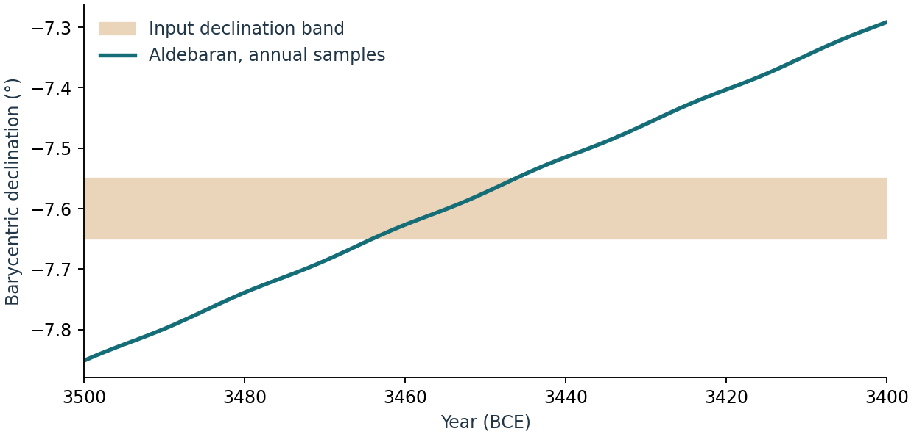

# Identifying celestial candidates and limiting declinations {#sec-celestial-targets}

Build 2.0.9009 uses annual local solar and lunar limits for dated overlays and compares target ranges before rounding. [A08](a08-target-ranges.qmd) reproduces the earlier range discrepancy and checks the correction.

**Implementation.** skyscapeR 2.0.9004, `R/data-analysis.R`, `R/events.R`, `R/horizon.R`, `R/mechanics.R`, `R/misc.R` and `R/stars.R`. A field sightline defines a range of possible declinations. The relevant question is which celestial targets enter that band during the archaeological date range, and which could actually have been seen from that viewpoint. The first question can be computed before tackling the second. Silva & Lomsdalen (2025, table 5) illustrate this distinction when screening stellar candidates for the Maltese temples [@silvaloms2025].

## Construct the search band {#target-band}

For geometric altitude $h$ above the astronomical horizontal, true bearing $A$ and latitude $\phi$, $\sin\delta=\sin\phi\sin h+\cos\phi\cos h\cos A$ [@silva2020, eq. 1]. Use the [density chapter](orientation-densities.qmd) when uncertainty across bearings or skyline heights changes the resulting distribution. Decide whether the search interval is an architectural opening, a highest-density region, or a cluster identified in a significance test. These represent different quantities. If several high-density regions are disjoint, search them separately; taking only the smallest and largest endpoints would admit targets in the intervening gaps. A declination band also loses the distinction between the eastern and western branches of a track.

[`hor2max.dec()`](fn-hor2max-dec.html) searches bearings in a sector of half-width `range` around north; [`hor2min.dec()`](fn-hor2min-dec.html) searches around south. In each case the step is 0.01° and the default half-width is 25°. The routines pass the sampled bearings and skyline to [`az2dec()`](fn-az2dec.html) and return the extreme of the resulting declinations. With a scalar latitude they instead use the supplied constant altitude. On a level horizon at 40° N with refraction off, the meridian extrema are ±50°. The following synthetic horizon keeps the meridians level but puts a ridge at bearings 10–12°.

```r
skyscapeR.vars(refraction = FALSE)
h <- createHor(c(0, 7, 10, 12, 15, 180, 360), c(0, 0, 12, 12, 0, 0, 0),
               loc = c(40, 0, 400))
hor2max.dec(h, range = 5)    # 50.00 degrees
hor2max.dec(h, range = 25)   # 60.6409 degrees
hor2min.dec(h)               # -50.00 degrees
```

The wider search picks up the northern ridge. A meridian-only calculation misses more than ten degrees of accessible declination here. These are sampled *terrain sightline* limits. The default restricted sectors do not guarantee global extrema on every possible skyline.

## Solar and lunar reference limits {#target-limits}

Let $\epsilon(y)$ be the true obliquity obtained from Swiss Ephemeris for the year's January reference instant. With no site supplied, [`jS()`](fn-js.html) and [`dS()`](fn-ds.html) return $+\epsilon$ and $-\epsilon$; [`eq()`](fn-eq.html) returns zero. These are reference declinations. An equinox instant, the Sun's position at sunrise on the equinox date, and the eastern spatial midpoint of the solstitial bearings at a particular site are three distinct quantities [@ruggles1997; @sweprog].

The standstill construction adopts $i_*=5.145°+0.145°$. Before local parallax the northern major and minor limits are $\epsilon+i_*$ and $\epsilon-i_*$; the southern values have the opposite signs. These are the four functions [`nMjLX()`](fn-nmjlx.html), [`nmnLX()`](fn-nmnlx.html), [`sMjLX()`](fn-smjlx.html) and [`smnLX()`](fn-smnlx.html). The distinction between a theoretical lunar extreme and an observed Moon is central to archaeological interpretation [@sprajc2016]. The fixed additional term is a skyscapeR implementation choice. The model does not search the lunar ephemeris for an extremum at a particular lunation.

With a site supplied the limit functions subtract the approximate signed correction $p\cos(h)\sin(\phi)$, with $p$ the adopted horizontal parallax (default lunar value 0.952°, solar value 0.00224°). Report the altitude, site and convention when comparing a local limit with a point in a catalogue. The worked 2026 geocentric values are ±23.43813° for the solstices, ±28.72813° for the major lunar extremes and ±18.14813° for the minor ones.

[`zenith()`](fn-zenith.html) and [`antizenith()`](fn-antizenith.html) use $\phi$ and $-\phi$ as the geometrical reference declinations and apply the specified parallax correction. Solar passage eligibility is checked against the solstitial limits using the session's default epoch; neither function accepts the dating interval of a target search. This matters near the tropical boundary. [`spatial.equinox()`](fn-spatial-equinox.html) is instead explicitly horizon- and epoch-dependent; the [event chapter](event-searches.qmd) explains its first-emergence and final-disappearance rule.

## Candidate screening by family {#target-screen}

[`findTargets()`](fn-findtargets.html) receives a closed declination band and one year or an inclusive range. For generic candidate bounds $[d_1,d_2]$ and measurement bounds $[L,U]$, overlap requires $d_1\leq U$ and $d_2\geq L$. The implementation does not construct or search every family in exactly the same way.

| Candidate | Construction and resolution |
|---|---|
| Sun | Solstitial limits are evaluated by year. Astronomical equinox is a zero-declination entry; equinox and solstice labels use the endpoint years' apparent solar longitudes. The generic sunrise/set row samples the declination band at 0.01° and solves for solar civil dates in the endpoint years. Those are declination-date windows, not timed local skyline crossings. |
| Spatial equinox | Requires a horizon. Collect finite eastern and western midpoint declinations at the two endpoint epochs, then take the enclosing range. The envelope can include intermediate declinations that correspond to neither side, and an intermediate epoch can behave differently. Check east and west individually for a specific sightline. |
| Moon | Test the four analytical standstill ranges across the years. In this build the solar and lunar output limits are rounded to 0.01° before the final overlap filter. Recompute a marginal match near a boundary. EFM and crescent distributions are separate searches in the [crossover chapter](lunar-crossovers.qmd). |
| Stars and catalogue objects | Apply the catalogue V-magnitude cutoff (default 2.5), compute declination at noon UT on 1 January Gregorian in every year, and test overlap before rounding. With `dates = TRUE`, intersect each successive line segment with the band, merge contiguous intersections and round boundaries to whole years. Separate passages remain separate. |

**Worked screening example.** For a hypothetical band of −1.5° to +0.2° in 2020–2026, the magnitude-2.5 search returns the astronomical equinox and a stellar match for **Alnilam** (ε Ori, catalogue V = 1.69; declination −1.19° to displayed precision). The solar date windows are 16–21 March and 22–26 September. Those alternatives survive the same declination filter. Which branch is visible, at what altitude, during which season and in what light must be assessed separately.

```r
x <- findTargets(c(-1.5, 0.2), year = c(2020, 2026),
                 max.mag = 2.5, dates = TRUE)
x$solar
x$stellar
```

**Prehistoric date window.** In a second illustration the input years are 3500–3400 BCE, and the band is −7.65° to −7.55°. Aldebaran's annual declinations span **−7.85° to −7.29°** across the full century. The reported overlap is only **3464–3446 BCE**. The wide numerical bounds returned for the star describe its whole search-period track, whereas `daterange` reports when it crosses the narrower input band. This teaching band was deliberately centred on Aldebaran near the middle of the interval. Recovering the star here is no evidence for its selection by ancient observers.

{fig-alt="Aldebaran's declination moves from about minus 7.85 to minus 7.29 degrees between 3500 and 3400 BCE. Its track crosses the shaded minus 7.65 to minus 7.55 degree band for part of that century."}

At archaeological timescales the annual grid is convenient for screening. Subannual excursions, catalogue completeness, stellar variability, extinction and local visibility are outside the overlap calculation. An integrated cluster entry can meet the magnitude cutoff even though individual stars have different detectability. Preserve the band, dating evidence, catalogue identifier, magnitude threshold and branch; check the candidate with [`star.phases()`](fn-star-phases.html), [`riseset()`](fn-riseset.html) and [`sketchSky()`](fn-sketchsky.html) as appropriate. Screening a band selected after inspection remains exploratory.

## Overlays, fixed tracks and version-specific limits {#target-overlay}

[`skyObject()`](fn-skyobject.html) prepares named targets or numerical declinations for a plot. [`sky.objects()`](fn-sky-objects.html) is its compatibility alias. It can expand “solar extremes” and “lunar extremes”, retain graphic styles and carry different epochs for different groups. The horizon plot supplies the site for its tracks; the compass plot uses the object's stored location and a level horizon. A declination plot needs no location. A plotted track keeps its declination fixed through a diurnal rotation. For an instant-specific comparison use [`body.position()`](fn-body-position.html) in the desired frame and pass its numerical declination to the overlay.

There is a consequential difference between the range algorithms. A stellar overlay takes the range of annual January samples. For a varying solar or lunar limit the 2.0.9004 range helper samples from the first year in 100-year steps, fits a spline and evaluates it across the requested interval. A short interval can therefore have just one source sample. For `skyObject("June Solstice", c(2020, 2026))` the returned bounds are both **23.43621°**, whereas the direct 2026 geocentric value is **23.43813°**. The range helper also defaults to geocentric evaluation for these named limits when called from the two-epoch overlay. This is a reason to compute the underlying limits directly for the required sites and years before using a narrow overlay to classify a borderline match. The choice of a finer plotted grid cannot supply missing input epochs.

The strength of this workflow is traceability from an archaeological band through candidate dates to a site-specific reconstruction. Its output is a set of compatible geometries; it supplies neither a probability of target identity nor a correction for searching many stars, time ranges or subsections of the data. Matched comparisons of range envelopes against direct calculations and independent evidence of observational visibility remain separate tasks. [Reproduce the target and crossover examples](archives/crossovers-and-targets.zip).


**Related function entries**

[`findTargets()`](fn-findtargets.html), [`skyObject()`](fn-skyobject.html), [`sky.objects()`](fn-sky-objects.html), [`hor2min.dec()`](fn-hor2min-dec.html), [`hor2max.dec()`](fn-hor2max-dec.html), [`az2dec()`](fn-az2dec.html), [`createHor()`](fn-createhor.html), [`obliquity()`](fn-obliquity.html), [`jS()`](fn-js.html), [`dS()`](fn-ds.html), [`eq()`](fn-eq.html), [`parallax.corr()`](fn-parallax-corr.html), [`nMjLX()`](fn-nmjlx.html), [`nmnLX()`](fn-nmnlx.html), [`sMjLX()`](fn-smjlx.html), [`smnLX()`](fn-smnlx.html), [`zenith()`](fn-zenith.html), [`antizenith()`](fn-antizenith.html), [`spatial.equinox()`](fn-spatial-equinox.html), [`solar.date()`](fn-solar-date.html), [`star()`](fn-star.html), [`star.phases()`](fn-star-phases.html), [`riseset()`](fn-riseset.html), [`sketchSky()`](fn-sketchsky.html), [`body.position()`](fn-body-position.html), [`EFM()`](fn-efm.html), [`CC()`](fn-cc.html).
