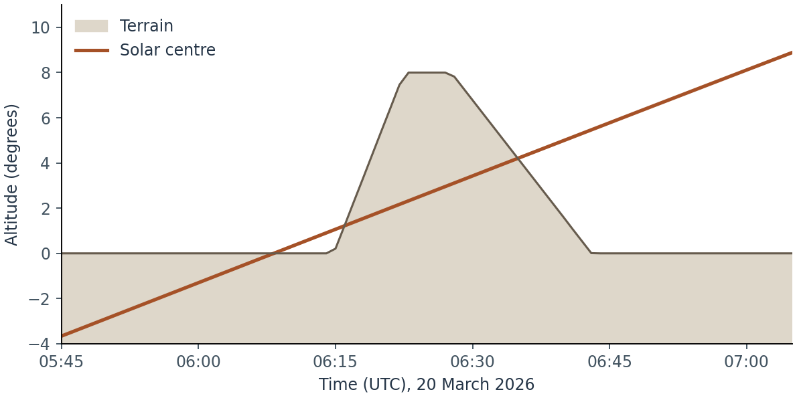

# Terrain crossings and event searches {#sec-event-searches}

[A05](numerical-validation.qmd#a05-solar-limits) tests civil dates, solstitial branches and independent east and west solutions for spatial equinoxes.

**Implementation.** skyscapeR 2.0.9004, `R/horizon-events.R`, `R/mechanics.R`, `R/events.R` and `R/misc.R`. A point on a track, a terrain crossing, a midpoint bearing, a date and a sampled extreme are five different outputs. Their numerical precision and their archaeological interpretation depend on different assumptions.

| Function | Quantity calculated | Search domain |
|---|---|---|
| [`orbit()`](function-methods.html#fn-orbit) | Horizontal track for one fixed declination | One turn sampled in right ascension |
| [`riseset()`](function-methods.html#fn-riseset) | Date, time, azimuth and declination of a centre crossing | Local skyline or constant horizon; terrain solver searches 48 hours |
| [`spatial.equinox()`](function-methods.html#fn-spatial-equinox) | Eastern and western spatial midpoint bearings and associated declinations | Rising and setting halves of two fixed solstitial tracks |
| [`solar.date()`](function-methods.html#fn-solar-date) | Civil date(s) on which the geocentric apparent solar declination reaches a target | Selected civil year in UT |
| [`planet.extremes()`](function-methods.html#fn-planet-extremes) | Minimum and maximum sampled planetary declination | Planet-dependent interval centred on the selected epoch |

Terrain crossing searches assume a complete skyline. A [partial photographic profile can yield events outside its observed sector](photographic-horizons.html#partial-photo-consumers).

The [A02 lunar skyline comparison](a02-ephemeris.qmd#lunar-bearings-at-the-skyline) quantifies how ephemeris conventions affect crossing times and azimuths. [A04](numerical-validation.qmd#a04-stellar-crossings) checks crossing times, bearings and event order against analytic tracks and independent root searches, including JPL solar and lunar centre crossings.

## Sampling a diurnal track {#event-track}

For a fixed declination, [`orbit()`](function-methods.html#fn-orbit) samples right ascension across a full turn, using `res` in degrees (default 0.25°). It transforms the sampled positions to horizontal coordinates for the supplied observer and atmosphere, retains altitudes above −20° and sorts the output by azimuth. The horizon object supplies the site; the function does not test each point for terrain clearance. Azimuth-sorted points do not give a time ordering or a local rise time. A fixed-declination track is useful for asking which part of the astronomical path could meet a ridge. A moving Solar System body on a particular morning requires its ephemeris.

## Crossing definition and selection {#event-crossings}

Let $A(t)$ and $h(t)$ be the topocentric bearing and centre altitude of the body, and $H(A)$ the terrain altitude interpolated at that bearing. The terrain solver seeks sign changes in

$$C(t)=h(t)-H\bigl(A(t)\bigr).$$

A change from negative to positive marks emergence; positive to negative marks disappearance. Touching the skyline and returning to the same side produces neither event. Select apparent or geometric altitude with `refraction`, and record the pressure and temperature. The `dec` setting controls the *reported* declination. The event geometry remains topocentric.

[`riseset()`](function-methods.html#fn-riseset) has distinct computational routes. For a Solar System body and numeric site coordinates, an explicit scalar `alt` is passed to the Swiss Ephemeris constant-horizon rise/set routine with the disc-centre convention [@sweprog]. For a horizon object, the package interpolates its complete profile; combining this with an explicit `alt` raises an error. Stellar tracks use the package crossing solver even for a constant altitude. For a dated terrain search, local midnight in the selected calendar and timezone defines the start, and the search runs for 48 hours. The function returns the **first upward and first downward crossing separately**. Either may be missing, either may be on the next day, and the reported set can occur before the reported rise.

A one-minute base interval is divided into quarters. Azimuth changes are unwrapped locally around north; the solver locates turning points and splits rapid or reversing azimuth motion to bracket passages across terrain vertices. On smooth subintervals whose endpoints have the same clearance sign, the solver checks for an interior extremum that could conceal a short emergence and reoccultation. Bracketed roots are refined to 0.01 s. Skyline altitude must agree at 0° and 360°. The root tolerance describes the numerical refinement; it cannot remove errors in terrain altitude, atmosphere or ancient time conversion. A near-tangency or near-zenith azimuth singularity also limits numerical completeness.

## Worked example: a Sun that sets in the morning {#event-ridge}

On 20 March 2026, place the observer at 51° N, 0° longitude and 100 m elevation. The synthetic skyline is level until bearing 91.5°, climbs to 8° at 93°, stays there to 94°, and drops to zero at 97°. Use the Gregorian calendar and UTC, with atmospheric refraction off. The ridge is deliberately positioned across the ascending solar track.

```r
ridge <- createHor(c(0, 91.5, 93, 94, 97, 360),
                   c(0,    0,  8,  8,  0,   0), loc = c(51, 0, 100))
events <- riseset(ridge, date = "2026/03/20", obj = "sun",
                  timezone = "UTC", calendar = "G", refraction = FALSE)
events$rise
events$set
```

| Returned event | UTC | True bearing | Physical interpretation |
|---|---|---:|---|
| Rise | 06:08:14 | 90.2233° | The centre emerges above the level eastern horizon. |
| Set | 06:15:57 | 91.7226° | The centre disappears behind the rising flank of the ridge. The Sun itself is still ascending. |

{fig-alt="The rising solar centre first clears level terrain, is obscured again by an eight-degree ridge, and then reappears on the other side of the ridge."}

The example script also evaluates solar altitude and skyline altitude at one-minute intervals. Clearance becomes positive again between 06:34 and 06:35 UTC. That second emergence is evident in the track but is not the first rise, so it has no second row in `events$rise`. The figure joins minute samples; the tabulated times above are the solver outputs. Neither calculation applies a naked-eye detection criterion. For a heliacal event use a candidate date from the [stellar visibility chapter](stellar-phases.qmd) and follow the star's altitude, extinction and twilight after clearance.

## Spatial midpoint and solar date {#event-midpoint}

Ruggles distinguished the spatial midpoint of the solstitial horizon bearings from definitions based on time or equatorial declination [@ruggles1997]. [`spatial.equinox()`](function-methods.html#fn-spatial-equinox) constructs fixed tracks at $\delta=\pm\epsilon$ for the epoch's obliquity. It applies solar parallax before atmospheric refraction, follows each track from lower culmination to lower culmination, and selects first emergence on its rising half and final disappearance on its setting half. This is a different selection rule from the first downward crossing returned by [`riseset()`](function-methods.html#fn-riseset).

For each side let $A_1,A_2$ be the two solstitial bearings. The result uses the midpoint of the shorter circular arc, $A_m=(A_1+\mathrm{wrap}_{180}(A_2-A_1)/2)\bmod 360°$. At that bearing the package interpolates the terrain and inverts refraction and mean solar parallax to obtain geocentric declination. A missing required crossing makes that side undefined; opposite bearings have no unique shorter arc. Polar configurations, complete obstruction or a tangency can therefore yield `NA`. The 2.0 development implementation made epoch and atmosphere explicit and revised the crossing selection; recalculate historical spatial-equinox targets if these conventions matter.

As a separate example, give the same site a 10° northeastern plateau from bearings 35° to 65°, sloping to level ground at 25° and 75°. For 2026, the eastern midpoint is **97.059°**, equivalent to declination **−4.434°**; the western midpoint is **269.996°**, equivalent to approximately 0°. The two sides of one site can therefore imply different solar dates. These bearings come from geometric, solar-centre tracks with the package's default parallax and refraction off.

[`solar.date()`](function-methods.html#fn-solar-date) solves a different equation: $\delta_{\odot}(t)-\delta_{\mathrm{target}}=0$. It samples daily geocentric apparent declinations, uses adjacent samples to bracket turning points, refines the extrema and solves for roots on the monotonic sections. The civil year includes its first midnight UT and excludes the next year's first instant. Near a solstice, two nearby roots may fall on one civil day; a tangency gives one root. A requested value outside the annual range has no root. The routine returns dates, omitting unavailable targets with a message when verbose, and errors if none are attainable. In 2026, a target of 0° returns **20 March and 23 September** in the Gregorian calendar regardless of which terrain profile was used for the midpoint.

## Sampled planetary extrema {#event-planets}

[`planet.extremes()`](function-methods.html#fn-planet-extremes) sets an interval extending three quarters of its planet-specific period on either side of the chosen year and rounds the endpoints to years. The constants in this build are 6.989733 years for Mercury, 8 for Venus, ten times 687/365.25 for Mars, 4331/365.25 for Jupiter and 10747/365.25 for Saturn. These are search-window parameters. The routine samples the ephemeris daily at noon UT from 1 January of the starting year through 1 January of the ending year, taking the range of the returned declinations. Supply a site for local positions and record the declination convention. Without a site the example uses geocentric positions.

For Venus at epoch 2026 the window is 1 January 2020 through 1 January 2032. The geocentric sampled range was **−27.32186° to +27.81592°** in the archived example. The digits identify the calculation. Sampling at noon can miss an intervening extremum; increasing the printed precision supplies no bound on that error. This routine neither refines continuous extrema nor returns their event times. A comparison with another ephemeris must match the body, frame, site, time interval and sampling cadence before its residuals can be interpreted.

## Interpretation, limits and reproduction

A terrain solver can resolve multiple skyline encounters on the same ascending track; the constant-altitude solver answers a simpler question. Neither supersedes a field survey of the ridge or an explicit decision about whether the archaeological event concerns a centre, a limb or an observable star. For date and extremum searches, distinguish errors due to the ephemeris from those introduced by the chosen event definition or temporal sampling. Useful future checks include known short crossing pairs, nearly tangent tracks, solstitial targets close to the annual limit and extrema bracketed by daily planetary samples.

[Download the scripts, example outputs and ephemeris identifiers](archives/doorway-and-ridge-examples.zip). All three event examples were executed with skyscapeR 2.0.9004 and swephR 0.3.2. The paired modern Swiss data files used for these examples identify DE441 in their headers. Their checksums are in the example archive. They illustrate implementation behaviour; the [study register](study-register.qmd) retains the independent field and model-comparison evidence.


**Related function entries**

[`orbit()`](function-methods.html#fn-orbit), [`riseset()`](function-methods.html#fn-riseset), [`spatial.equinox()`](function-methods.html#fn-spatial-equinox), [`solar.date()`](function-methods.html#fn-solar-date), [`planet.extremes()`](function-methods.html#fn-planet-extremes), [`createHor()`](function-methods.html#fn-createhor), [`body.position()`](function-methods.html#fn-body-position), [`star.phases()`](function-methods.html#fn-star-phases), [`skyStep()`](function-methods.html#fn-skystep), [`sketchSky()`](function-methods.html#fn-sketchsky).
