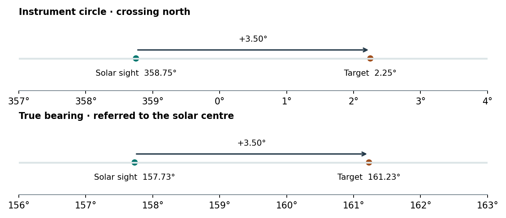

# Reducing compass and theodolite observations {#sec-field-reduction}

The package accepts a single site or a site per theodolite observation and reduces the final bearing modulo 360°. The control returns 161.23°. [W02 field controls](w02-field-to-sky.qmd).

**Implementation.** skyscapeR, `R/data-reduction.R`, `R/misc.R` and `R/mechanics.R`. A compass gives a direction relative to magnetic north. A theodolite gives an angle on an instrument circle whose zero may be arbitrary. Reduction places each observation on a true-bearing scale before the skyline or celestial declination is evaluated. Retain the original readings; two corrected numbers alone cannot reveal an erroneous correction sign, solar limb or time convention [@ruggles1999].

## Magnetic reference and observation date {#field-compass}

[`mag.dec()`](fn-mag-dec.html) evaluates IGRF-14 through `oce::magneticField()` at sea level for the survey latitude, longitude and date. The date is converted to a decimal year by dividing elapsed days since 1 January by the actual number of days in the year. This implementation accepts 1 January 1900 through 1 January 2030 inclusive. Supply one site and many dates, one date and several sites, or matched rows. The date is that of the instrument reading, even for a monument built millennia earlier [@igrf; @ocefield].

With east-positive magnetic declination $D$, [`reduct.compass()`](fn-reduct-compass.html) computes $A_T=A_M+D$. An explicit `magdec` takes precedence if a date is also supplied. A bearing and correction shared across measurements or paired corrections should retain their row identities. The routine rounds using the numeric representation of the input bearings. It does not reduce the reported sum modulo 360°. Where altitude is provided, it also calculates celestial declination. An explicit altitude takes precedence over a supplied horizon; otherwise the corrected true bearing is used to look up the horizon altitude.

At 35.84° N, 14.57° E on 20 February 2026 the model returned **+3.827142°**. The input and altitude columns below are illustrative readings.

| Magnetic reading | Supplied altitude | Returned true bearing | Bearing on a compass | Returned celestial declination |
|---:|---:|---:|---:|---:|
| 358.5° | 2° | 362.3° | 2.3° | 56.1° |
| 82.5° | 5° | 86.3° | 86.3° | 5.9° |

In particular, subtracting the positive correction would rotate the sightline in the wrong direction. IGRF models the main geomagnetic field. Local disturbance, instrument bias, a grid bearing mistaken for a magnetic bearing, or movement between observing positions require separate evidence. Numerical agreement with another IGRF implementation cannot test these field effects.

## Solar-reference reduction {#field-solar}

Let $r_T$ and $r_S$ be instrument-circle readings to the target and the observed solar point. If $A_S(t)$ is the predicted true bearing of that same solar point, the reduced bearing modulo one turn is

$$ A_T = [ A_S(t) + r_T-r_S ]\bmod 360°.$$

[`sunAz()`](fn-sunaz.html) parses the survey clock with R's civil-time machinery, converts it to UTC, forms a Gregorian Julian date and calculates a topocentric solar direction. Its horizontal calculation uses 1013.25 mbar and 15 °C. The centre is used if no limb is given. Left and right limbs subtract or add a fixed **16 arcminutes in azimuth**. Optional altitude is the geometric centre altitude. The fixed limb offset is an approximation; it does not vary with the apparent solar diameter or project a changing semidiameter onto azimuth at each altitude. This timestamp route is distinct from the proleptic ancient-date conversion in the [conventions chapter](astronomical-conventions.qmd).

[`reduct.theodolite()`](fn-reduct-theodolite.html) adds the observed circle difference to the computed solar reference, rounded according to the input readings. The function wraps the final bearing into the interval from 0° inclusive to 360° exclusive. A single location vector can be shared by all readings, or a location matrix can specify one site per observation.

The optional `name`, `ID` and `HWT.ID` fields identify output records. Supplying a HeyWhatsThat ID in these reduction functions records it in the table. To use the external skyline, retrieve the horizon with [`downloadHWT()`](fn-downloadhwt.html) and supply the resulting object as the location; an explicit measured altitude takes precedence.

## Worked circle reading {#field-example}

At the same site on 20 February 2026 at **11:07:17 Europe/Malta**, the calculated solar bearings were 157.4611° for the left limb, 157.7278° for the centre and 157.9944° for the right limb. A clock one minute later changed the centre bearing by **+0.30759°** in this example. That is a local time sensitivity, not a universal correction.

```r
site <- matrix(c(35.84, 14.57, 100), nrow = 1)
r <- reduct.theodolite(site, az = 2.25, az.sun = 358.75,
    date = "2026/02/20", time = "11:07:17", tz = "Europe/Malta", alt = 2)
r$True.Azimuth
```

The instrument crossed north by **+3.50°** between the solar and target readings. The rounded solar reference is 157.73°. The routine returns **161.23°**, the direction obtained by adding 3.50° to the solar reference. The companion script also includes a non-wrapping reading and a compass reduction. These examples show why retaining the solar reading, limb, timestamp, timezone and original circle values matters when recovering a field result.

{fig-alt="The instrument turn crosses north. The same turn takes the true bearing from 157.73 to 161.23 degrees."}

The international [H01](h01-field-validation.qmd) field comparison evaluates DEM skylines against already reduced bearings. F01 below uses a separately established terrestrial bearing. [Download the synthetic field records and reduction scripts](archives/conventions-field-panorama.zip).


## F01 · Independent bearings and a recorded solar survey {#f01-scientific}

Three synthetic baselines used WGS84 inverse-geodesic bearings. The solar circle readings were constructed from independent centre bearings, including Reda and Andreas’s Golden, Colorado example (194.34024°). The Malta and southern-hemisphere controls used Astronomy Engine. The largest wrapped errors were **0.00035°** for solar reduction and below $10^{-10}$ degrees for compass readings with supplied magnetic corrections. A separate comparison of `mag.dec()` with the independent ppigrf implementation of IGRF-14 covered five sites on five dates from 1900 to 2029. The maximum difference was **0.000070°**. Both implementations use the same geomagnetic field coefficients. Local magnetic disturbance and instrument bias require field measurements.

Hugh B. Crawford’s survey at Waldo, Kansas, on 13 October 1944 provides an observational test. The independent Polaris bearing to the west edge of the post was 1′07″ east of north. The measured angle between edges was 1′35″, giving **0.045°** to the east edge sighted in the solar series. The three pairs used opposite solar limbs and both telescope faces. The test uses each pair’s mean circle deflection as a centre sight, converts its recorded local apparent solar time to UTC, and uses the southward prolongation of the line to interpret the deflection.

| Recorded apparent time | Recovered true bearing | Signed error against Polaris |
|---|---:|---:|
| 08:40 | 359.656° | −0.389° |
| 08:45 | 0.144° | +0.099° |
| 08:50 | 0.574° | +0.529° |

The equal-weight mean signed error was +0.080°. Crawford’s own altitude-based reduction gave 0.051° for the post. The notebook gives one time per pair at five-minute spacing and lacks individual timestamps. All three pairs share one baseline. These differences therefore cannot establish a time correction, an instrument calibration or general field accuracy. A timed compass traverse tied to surveyed endpoints remains open. [General Land Office field records, printed pp. 41 and 62–63](https://archive.org/details/examplesofgoodpr00unit). [Solar Position Algorithm](https://doi.org/10.1016/j.solener.2003.12.003). [Independent geomagnetic reference](https://github.com/IAGA-VMOD/ppigrf).

[Download the study scripts, reference inputs and numerical results](archives/scientific-studies.zip).

**Related function entries**

[`mag.dec()`](fn-mag-dec.html), [`reduct.compass()`](fn-reduct-compass.html), [`hor2alt()`](fn-hor2alt.html), [`sunAz()`](fn-sunaz.html), [`reduct.theodolite()`](fn-reduct-theodolite.html), [`az2dec()`](fn-az2dec.html).
