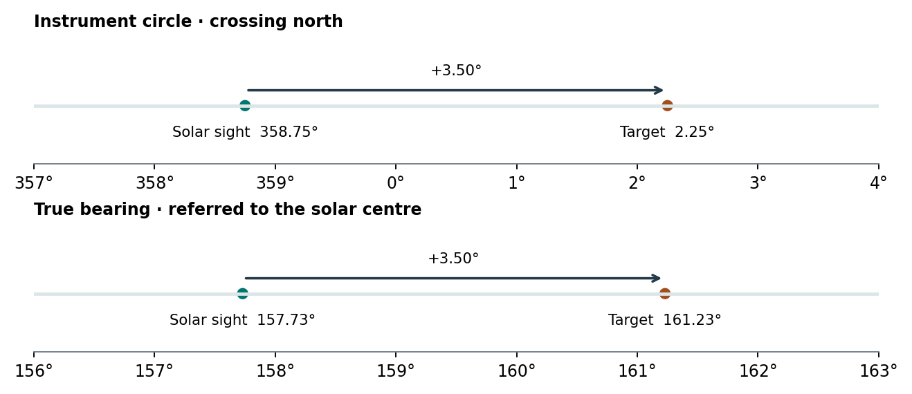

# Reducing compass and theodolite observations {#sec-field-reduction}

**Implementation.** skyscapeR 2.0.9004, `R/data-reduction.R`, `R/misc.R` and `R/mechanics.R`. A compass gives a direction relative to magnetic north. A theodolite gives an angle on an instrument circle whose zero may be arbitrary. Reduction places each observation on a true-bearing scale before the skyline or celestial declination is evaluated. Retain the original readings; two corrected numbers alone cannot reveal an erroneous correction sign, solar limb or time convention [@ruggles1999].

## Magnetic reference and observation date {#field-compass}

[`mag.dec()`](function-methods.html#fn-mag-dec) evaluates IGRF-14 through `oce::magneticField()` at sea level for the survey latitude, longitude and date. The date is converted to a decimal year by dividing elapsed days since 1 January by the actual number of days in the year. This implementation accepts 1 January 1900 through 1 January 2030 inclusive. Supply one site and many dates, one date and several sites, or matched rows. The date is that of the instrument reading, even for a monument built millennia earlier [@igrf; @ocefield].

With east-positive magnetic declination $D$, [`reduct.compass()`](function-methods.html#fn-reduct-compass) computes $A_T=A_M+D$. An explicit `magdec` takes precedence if a date is also supplied. A bearing and correction shared across measurements or paired corrections should retain their row identities. The routine rounds using the numeric representation of the input bearings. It does not reduce the reported sum modulo 360°. Where altitude is provided, it also calculates celestial declination. An explicit altitude takes precedence over a supplied horizon; otherwise the corrected true bearing is used to look up the horizon altitude.

At 35.84° N, 14.57° E on 20 February 2026 the model returned **+3.827142°**. The input and altitude columns below are illustrative readings.

| Magnetic reading | Supplied altitude | Returned true bearing | Bearing on a compass | Returned celestial declination |
|---:|---:|---:|---:|---:|
| 358.5° | 2° | 362.3° | 2.3° | 56.1° |
| 82.5° | 5° | 86.3° | 86.3° | 5.9° |

In particular, subtracting the positive correction would rotate the sightline in the wrong direction. IGRF models the main geomagnetic field. Local disturbance, instrument bias, a grid bearing mistaken for a magnetic bearing, or movement between observing positions require separate evidence. Numerical agreement with another IGRF implementation cannot test these field effects.

## Solar-reference reduction {#field-solar}

Let $r_T$ and $r_S$ be instrument-circle readings to the target and the observed solar point. If $A_S(t)$ is the predicted true bearing of that same solar point, the reduced bearing modulo one turn is

$$ A_T = [ A_S(t) + r_T-r_S ]\bmod 360°.$$

[`sunAz()`](function-methods.html#fn-sunaz) parses the survey clock with R's civil-time machinery, converts it to UTC, forms a Gregorian Julian date and calculates a topocentric solar direction. Its horizontal calculation uses 1013.25 mbar and 15 °C. The centre is used if no limb is given. Left and right limbs subtract or add a fixed **16 arcminutes in azimuth**. Optional altitude is the geometric centre altitude. The fixed limb offset is an approximation; it does not vary with the apparent solar diameter or project a changing semidiameter onto azimuth at each altitude. This timestamp route is distinct from the proleptic ancient-date conversion in the [conventions chapter](astronomical-conventions.qmd).

[`reduct.theodolite()`](function-methods.html#fn-reduct-theodolite) adds the observed circle difference to the computed solar reference, rounded according to the input readings. For $|r_T-r_S|>180°$ this build subtracts a full turn from the difference, including when it is already negative. It does not wrap the final sum. The resulting number represents the correct direction modulo 360° but can be far outside the normal horizon lookup range. For a crossing of north, retain the raw result and compute `True.Azimuth %% 360` before matching a profile; for that case one can reduce the bearing first and then pass the wrapped value and measured altitude to [`az2dec()`](function-methods.html#fn-az2dec). With one observation, a one-row, three-column location matrix works in this build; a plain three-element vector can fail in the internal matrix indexing.

The optional `name`, `ID` and `HWT.ID` fields identify output records. Supplying a HeyWhatsThat ID in these reduction functions records it in the table. To use the external skyline, retrieve the horizon with [`downloadHWT()`](function-methods.html#fn-downloadhwt) and supply the resulting object as the location; an explicit measured altitude takes precedence.

## Worked circle reading {#field-example}

At the same site on 20 February 2026 at **11:07:17 Europe/Malta**, the calculated solar bearings were 157.4611° for the left limb, 157.7278° for the centre and 157.9944° for the right limb. A clock one minute later changed the centre bearing by **+0.30759°** in this example. That is a local time sensitivity, not a universal correction.

```r
site <- matrix(c(35.84, 14.57, 100), nrow = 1)
r <- reduct.theodolite(site, az = 2.25, az.sun = 358.75,
    date = "2026/02/20", time = "11:07:17", tz = "Europe/Malta", alt = 2)
r$True.Azimuth
r$True.Azimuth %% 360
```

The instrument crossed north by **+3.50°** between the solar and target readings. The rounded solar reference is 157.73°. The routine returns **−558.77°**, equivalent to **161.23°**, the direction obtained by adding 3.50° to the solar reference. The companion script also includes a non-wrapping reading and a compass reduction. These examples show why retaining the solar reading, limb, timestamp, timezone and original circle values matters when recovering a field result.

{fig-alt="The instrument turn crosses north. The same turn takes the true bearing from 157.73 to 161.23 degrees."}

The international [H01](study-register.qmd#h01-field-validation) field comparison evaluates DEM skylines against already reduced bearings. Independent validation of the two reduction functions requires a different reference. The relevant future check is a repeat solar or magnetic orientation of a baseline with independently established endpoints, accompanied by instrument readings, timestamps, atmospheric conditions and positional uncertainties. [Download the synthetic field records and reduction scripts](archives/conventions-field-panorama.zip).

**Related function entries**

[`mag.dec()`](function-methods.html#fn-mag-dec), [`reduct.compass()`](function-methods.html#fn-reduct-compass), [`hor2alt()`](function-methods.html#fn-hor2alt), [`sunAz()`](function-methods.html#fn-sunaz), [`reduct.theodolite()`](function-methods.html#fn-reduct-theodolite), [`az2dec()`](function-methods.html#fn-az2dec).
