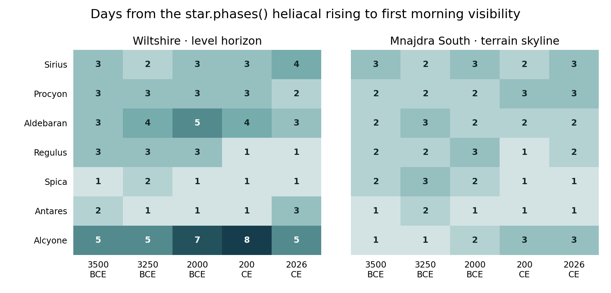

# Checking the date of heliacal rising {#sec-rising}

**Question.** How close is the seasonal date from [`star.phases()`](fn-star-phases.html) to the first morning that a second visibility model puts the star above its detection threshold?

**Finding.** In 69 of 70 comparable cases, the two dates fell within one week of each other. The comparison uses modelled visibility at dawn. Assessing accuracy against what people actually saw would require dated naked-eye observations.

## Sites, stars and epochs

The main design crossed eight stars with five epochs (3500, 3250 and 2000 BCE, 200 and 2026 CE) and two horizons. Wiltshire used a level horizon at 51.18° N, 1.83° W. Mnajdra South used a terrain skyline from the package. The Mnajdra runs allowed all bearings and held the skyline fixed across epochs. The comparison makes no claim that either monument was in use throughout the sampled period.

Capella produced no heliacal-rising event in the ten site–epoch combinations. Its ten rows remain in the download with blank event dates. The resulting 70 comparisons represent seven stars. Five southern-star cases at Mnajdra form a separate follow-up and are excluded from the headline count.

## Comparator and shared inputs

The reference date comes from [`star.phases()`](fn-star-phases.html). The comparator searches mornings around that date on a one-minute grid. It evaluates extinction-adjusted point-source flux against the local background radiance, applying the point-source contrast threshold of @crumey2014 [eqs. 32–33]. A minute above threshold qualifies. The search covered 24 days on either side of the reference date, extended to 64 days where necessary. The experiment therefore checks agreement near the selected event.

The two calculations share the site, ephemeris and stellar catalogue. The assumed central dark-sky limit was magnitude 6, extinction was 0.20 magnitudes per airmass, refraction was disabled and the Moon was hidden. The benchmark used the twilight and sky-brightness model in development build 2.0.9003. Its threshold is applied to radiance before display compression. It is a criterion used by this study.

## Results and their scope



{fig-alt="Two matrices show the differences in days at Wiltshire and Mnajdra. Most differences are one to three days. The largest is eight days for Alcyone at Wiltshire in 200 CE."}

The week is a useful rule of thumb for agreement over this grid. The cases reuse stars, sites and model inputs. They do not estimate a 69-in-70 probability for an archaeological observer. The study also varied the assumed dark-sky limit to magnitudes 5.5 and 6.5. The corresponding offsets are supplied for each case so the reader can examine sensitivity to that choice.

## Reproduce the comparison

* [Download the per-case results](study/results.csv). Positive `calibrated_days` means that the comparator's first qualifying morning fell later than the phase date. The table carries the main/follow-up label, the event dates and the alternative model outputs.
* [Download the archived test](archives/heliacal-rising-test.zip). It contains the original R scripts, the Python export script, daily margins, checks through the public renderer and the study README.
* [Download the package source used in the test](archives/skyscapeR_2.0.9003.tar.gz). Reproduction also requires the fixed-star catalogue and Swiss Ephemeris files covering the epochs, the package's R dependencies and Python with pandas, NumPy and Matplotlib.

For a full rerun, install the archived build in a separate R library. Unpack the test, change to its directory and follow the README, running `phases.R`, `scan.R`, `verify.R`, `refine.R`, `symbol-check.R` and then `export.py`. On Windows, set `mc.cores = 1` in the fork-based calls. For a quick check using the saved outputs, the manual's `scripts/prepare.R` recalculates the summary from the CSV every time the book renders. The figure comes from the archived study. The full astronomical search has not been rerun for this edition.

[Return to the method](stellar-phases.qmd).

**Related function entries**

[`star.phases()`](fn-star-phases.html).
