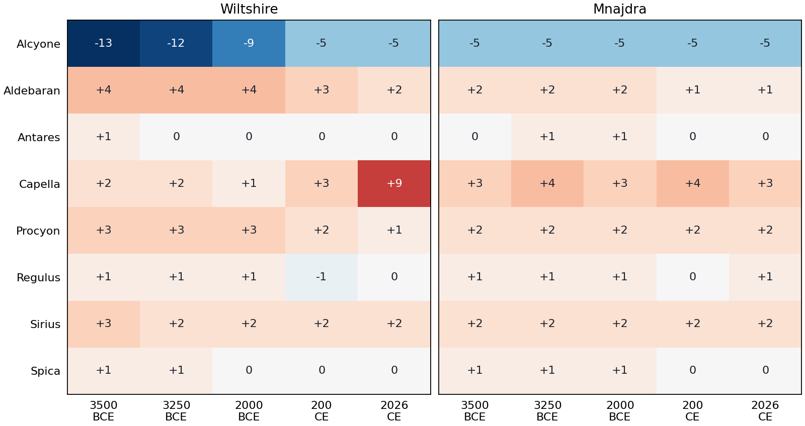

# First morning and last evening visibility {#sec-rising}

## Recorded sightings {#v01-observations}

How close does the default `star.phases()` calculation come to a recorded first or last sighting? We ran the package on 56 dated stellar events from the public HeliacalPhases catalogue examined in connection with Victor Reijs’s analysis of Kolev’s observations. The catalogue supplies the date, location and extinction. We assumed a level skyline, refraction on and a zenith limiting magnitude of 6. One zero extinction entry used 0.20 magnitudes per airmass. No coefficient was fitted to these dates. [Reijs’s analysis](https://www.archaeocosmology.org/eng/Kolev-Phases.htm) and [observation catalogue](https://heliacalphases.com/?lng_id=3&p=1).

Error below is the predicted local date minus the observed date. A negative number means the package predicted the event early. Every observation had one matching event.

| Observed event | Package event | Mean absolute error | Median error | Range | Within seven days |
|:---|:---|---:|---:|---:|---:|
| First morning | Heliacal rising | 2.78 days | −2 days | −9 to +2 days | 22/23 |
| Last evening | Acronycal setting | 7.64 days | +5 days | −13 to +25 days | 21/33 |

Across all 56 dates the mean absolute error was 5.64 days. A week is a reasonable starting window for exploring a reconstruction. At dusk, 12 of 33 predictions fell outside that window. The records include repeated stars and sites. The figures describe this sample and give no uncertainty estimate for the other two phase events or for a rising azimuth.

## Detections and unsuccessful searches

We also scored the morning or evening visibility flag directly on all 45 observing sessions in Schaefer’s Table 1, using each session’s extinction and limiting magnitude. The prediction matched 18 of 31 morning sessions and 9 of 14 evening sessions. Barely detected counts as seen. Schaefer used this observing campaign to develop the model. These data test reconstruction of the detection criterion. At six separately documented Sirius sightings the predicted first morning ranged from the recorded date to three days earlier. A sighting alone places an upper bound on the date of first visibility. [Observations and equations](https://doi.org/10.1177/002182868701801103).

## Timed Sirius sightings

We replayed 12 timed records through the package, scanning each minute from 40 minutes before to 65 minutes after the recorded time. For the three principal Sirius sightings, the seasonal date matched the Tashla date and preceded the Seattle dates by two days in 2003 and one day in 2005. In the natural sketch, only Seattle 2003 crossed the contrast threshold, from one minute before the reported onset to eight minutes after it. Tashla and Seattle 2005 had no qualifying minute under the assumed sky, skyline and observer limit. A successful seasonal-date prediction can therefore accompany a missed timed sighting. [Kolev’s Sirius observing diary](https://www.babylonianastrology.com/downloads/The_Heliacal_Rise%20of%20Sirius-algorithm.pdf) and [Reijs’s clock table](https://www.archaeocosmology.org/eng/benchmarking.htm).

## Published reference calculations

We ran the public function on all 28 entries of Schaefer’s Table 3 using the specified stellar positions, extinction, zenith limiting magnitude and latitude, with geometric stellar altitudes. The package returns an integer civil date. We compared its midpoint with the published fractional number of days after the March equinox. Twenty entries agreed within one day. The largest discrepancy was Izar at 60° N, 289.31 days after the equinox against the published 284.3. The high-latitude difference remains unresolved. [Schaefer (1987), Table 3](https://doi.org/10.1177/002182868701801103).

## Comparison with a dawn sky reconstruction

At a level Wiltshire horizon and the Mnajdra South terrain skyline, we crossed eight stars with five epochs (3500, 3250 and 2000 BCE, 200 and 2026 CE). We scanned neighbouring mornings for the first detectable rising star within 10° of the astronomical horizon under the natural sky model, using the local radiance and a Crumey point-source threshold. We used geometric skyline clearance, extinction 0.20 magnitudes per airmass, limiting magnitude 6 and moonlight switched off. The seasonal Schaefer search can find the star above the sketch test’s 10° ceiling.

Both calculations returned dates for all 80 combinations. The sketch threshold fell within seven days of the seasonal date in 76 cases. The median difference was one day later. The range ran from 13 days earlier for Alcyone in Wiltshire in 3500 BCE to nine days later for Capella there in 2026 CE. The five additional southern stars at Mnajdra agreed within two days. This measures agreement between two models under specified assumptions. The field observations above measure agreement with people’s sightings.

[Download the observing records, Table 3 inputs, scripts and per-record predictions](archives/stellar-visibility-observations.zip). [Download the dawn-sky scans and refinements](archives/visibility.zip). [Read the stellar phase method](stellar-phases.qmd).
