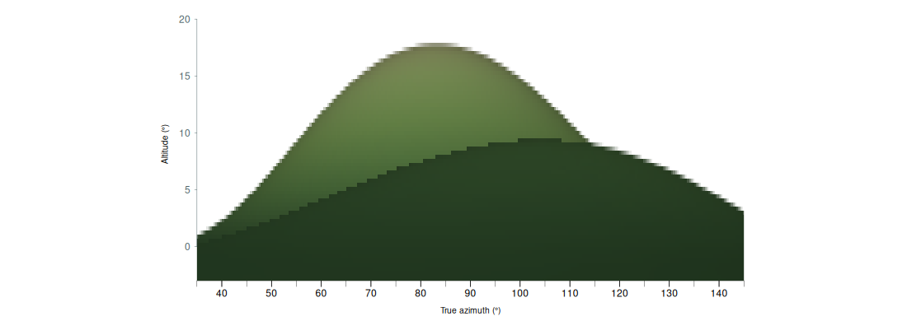

# Constructing a site horizon {#sec-horizon}

**Function** [`createHor()`](function-methods.html#fn-createhor) · **Package** skyscapeR 2.0.9004

A skyline is the altitude of the obstruction at each bearing from a particular viewpoint. [`createHor()`](function-methods.html#fn-createhor) builds this profile from observations or predicts it from a digital elevation model (DEM). Both routes return the same kind of horizon object. The evidence between adjacent bearings is quite different.

## From field measurements

Supply the measured bearings and altitudes in degrees, with the observer's latitude, longitude and elevation. The constructor repeats the measurements on either side of north, removes duplicate bearings and linearly interpolates both altitude and the supplied altitude uncertainty. This gives a continuous profile across north on a 0.01° grid. The grid is convenient for evaluating a sightline at any bearing. A narrow notch between two measurements can still be absent from the result.

For example, two measured points of equal altitude on opposite sides of a notch produce a level interpolated skyline between them. Record a foresight at the bottom of the notch if that feature matters to the interpretation. Repeated readings at the same bearing should be reduced to an estimate and uncertainty before calling the constructor. Optional smoothing averages over neighbouring samples and can lower a peak or fill a notch. With the default smoothing width of 1,000 samples, the window spans about 10°. Smoothing is off by default.

## From an elevation model

1. **Place the observer.** The function samples the ground height at the site unless an elevation is supplied explicitly, then adds `eye.height`. Supply numeric latitude and longitude in that order for the default WGS84 route. When `loc.crs` is explicit, coordinates are in x, y order. A point object with its own coordinate reference system removes that ordering ambiguity. Ground height and DEM elevations must use compatible vertical datums.
2. **Trace rays.** A local azimuthal equidistant projection supplies distances and bearings clockwise from true north. Along each ray the function samples the source raster by bilinear interpolation, calculates the elevation angle to each terrain sample and keeps the maximum. A more distant ridge may set the horizon even if the near terrain rises steeply.
3. **Correct the terrain angle.** The default combines Earth curvature and terrestrial refraction using the pressure, temperature and vertical temperature gradient in Patat's approximation [@patat2011, eqs. 1–2]. With an explicit `refraction.k`, the calculation uses an effective Earth radius. Zero retains geometric curvature. With `curvature = FALSE`, it uses the uncorrected height difference and distance. Refraction along a terrain sightline is a separate choice from astronomical refraction applied later to a star or the Sun.
4. **Retain the profile and its provenance.** Record the elevation product and date, horizontal and vertical reference systems, observer position and height, sampling settings, coverage and any reconstructed features. The optional panorama has its own sampling and lighting. Changing its pixel width cannot recover a ridge missed by the numerical rays.

### Which point supplies the skyline?

For an observer at elevation $z_o$ (including eye height), the solver maximises the apparent terrain angle over finite samples along each ray. In the default Patat branch, with ground elevation $z_i$, horizontal distance $d_i$, and local Earth radius $R$, the candidate angle in radians is

$$
h_i=\arctan\!\left(\frac{z_i-z_o}{d_i}-\frac{d_i}{2R}\right)+C\frac{d_i}{R},
\qquad C=\frac{0.252\,P\,(34.2+g)}{(T+273.15)^2}.
$$

Here $P$ is pressure in mbar, $T$ is temperature in °C, and $g$ is the vertical temperature gradient in °C/km. The retained altitude is $\max_i h_i$. A lower but nearer ridge can therefore conceal higher ground beyond it. This is the terrestrial light path from terrain to observer. Atmospheric refraction applied subsequently to a celestial position is a separate calculation [@patat2011]. With a supplied constant refraction coefficient $k$, the code instead uses the spherical geometry of an effective radius $6\,371\,008.8/(1-k)$ metres. With curvature disabled it uses $\operatorname{atan2}(z_i-z_o,d_i)$.

For search distance $D$ and requested radial step $s$, the ordinary numerical rays use $n=\max(2,\lceil D/s\rceil)$ samples at $d_i=iD/n$. The default $s$ is half the smaller local raster-cell dimension. The base bearing grid similarly uses $\lceil 360/\texttt{az.step}\rceil$ equally spaced rays, supplemented for reconstructed features. Bilinear sampling can smooth a narrow crest. A denser output grid cannot recover a crest absent from the terrain data. If the ray has missing coverage, its largest available angle can underestimate the skyline. The source metadata records incomplete bearings. When examining a disputed foresight, inspect that bearing and the winning ridge distance before pooling errors across a station. [H01](study-register.qmd#h01-field-validation) gives per-station errors and compares DEMs over common bearings in Ireland.

## Generating a terrain panorama {#sec-dem-panorama}

The DEM route through [`createHor()`](function-methods.html#fn-createhor) produces two outputs: the numerical skyline in `h$data` and a shaded image of the terrain visible **below** it. A measured series of azimuths and altitudes supplies no distances, slopes or intervening surfaces from which to render that foreground. To make a panorama, supply a single-band DEM with elevations in metres, observer coordinates in the specified reference system, and an output directory. The R packages `terra` and `png` are required for this example.

```r
library(skyscapeR)
library(terra)

dem <- rast(xmin=499450, xmax=500550, ymin=5699450, ymax=5700550,
            resolution=5, crs="EPSG:32630")
xy <- xyFromCell(dem, seq_len(ncell(dem)))
east <- xy[, 1] - 500000
north <- xy[, 2] - 5700000
values(dem) <- 100 + 15 * exp(-((east-80)/35)^2 - ((north+30)/90)^2) +
    88 * exp(-((east-270)/70)^2 - ((north-40)/200)^2)

h <- createHor(dem=dem, loc=c(500000, 5700000), loc.crs="EPSG:32630",
               name="Two ridges", eye.height=1.6, max.distance=500,
               az.step=1, distance.step=2.5, panorama=TRUE, width=1024,
               image.dir="terrain-images", ncores=1)
stopifnot(file.exists(h$metadata$image$path))
plot(h, xrange=c(35,145), yrange=c(-3,21), use.image=TRUE)
```

For a survey, replace the synthetic surface with `rast("survey-dtm.tif")`, enter the actual observer coordinates and choose a search radius that includes any distant ridge liable to form the skyline. The DEM should cover that search area. Supply the dataset credit and terms using `attribution` and `license`. If working from a photograph with a sky mask, use the [photographic calibration chapter](photographic-horizons.qmd).

{fig-alt="Plot of the eastward view, with a dark foreground ridge rising to about ten degrees and a lighter distant crest reaching about eighteen degrees."}

### From terrain rays to image pixels

The output is a 2:1 equirectangular RGBA PNG covering 0–360° clockwise from north and −90° to +90° altitude. Column centres are displaced half a pixel from the north seam. The renderer interpolates the numerical skyline to each column to fix the upper edge and leaves sky pixels transparent. Along each column it traces near to far, tracking the greatest elevation angle encountered. For a row below the skyline, the first terrain segment that reaches its viewing angle supplies the visible surface. More distant terrain below that line is hidden. The renderer interpolates surface properties between samples. A reconstructed [`horFeature()`](function-methods.html#fn-horfeature) can change the foreground colours or relief even when a distant ridge still determines the upper edge.

| Setting | What changes |
|---|---|
| `az.step`, `distance.step`, `max.distance` | The bearings, radial sampling and outer limit used to calculate the numerical skyline. The outer limit also bounds the rendered terrain. |
| `width` | The number of panorama columns. Height is half the width. The default 4096 × 2048 has an angular pixel width of about 5.27 arcminutes. |
| `panorama.distance.step`, `panorama.acuity` | The radial spacing for the image. With the default adaptive rule, the effective angle is the larger of one PNG pixel and the requested acuity (default one arcminute). At distance $d$, the proposed step is the larger of the near step (normally one local DEM cell) and $d\tan\theta$, with $\theta$ the effective angle. A narrow ridge can fall between samples. Supply a fixed step in metres to check a critical feature, or `NULL` to reuse the numerical ray spacing. |
| `terrain.palette`, `land_cols`, `sea_cols`, `sea_level` | Colour the surface by elevation. Inspect the available ramps with [`demPalettes()`](function-methods.html#fn-dempalettes). A sea-level threshold can colour low-lying dry ground as water. Use `sea_level=NULL` where that interpretation is inappropriate. |
| `lighting`, `light.azimuth`, `light.altitude`, `ambient`, `haze` | Relief mode blends observer-facing and directional illumination. Directional mode uses the selected light direction. The hillshade has no cast shadows. For an inspection of the palette alone, set `ambient=1, haze=0`. The default illumination is illustrative and does not reconstruct illumination at a dated solar event. |

The example wrote a 1024 × 512 PNG. Its adaptive grid used 100 radial samples, with an effective angular target of 21.09 arcminutes. Inspect `h$metadata$image$sampling` for the values used on another DEM. Increasing image width alone leaves the numerical bearing grid unchanged. When a narrow bank or notch matters, check both grids.

### Keeping and reusing the image

`panorama=TRUE` is the DEM default. `image.dir` defaults to the working directory, and `h$metadata$image$path` identifies the actual file. An image-rendering failure can return a valid numerical horizon with a warning and no image metadata. Save the PNG alongside `saveRDS(h, "two-ridges.rds")`; the RDS stores its path and checksum. After moving the files, assign the result of [`relinkHor()`](function-methods.html#fn-relinkhor). [`plot.skyscapeR.horizon()`](function-methods.html#fn-plot-skyscaper-horizon) displays the terrain, [`sketchSky()`](function-methods.html#fn-sketchsky) places a sky above it, and [`exportStellarium()`](function-methods.html#fn-exportstellarium) packages it for Stellarium. The [interchange section](photographic-horizons.html#photo-interchange) describes that export.

[Download the runnable example, full-sphere PNG, eastern view and run log](archives/dem-panorama-example.zip). The terrain is synthetic and illustrates rendering and occlusion. The field comparisons in the [study register](study-register.qmd) evaluate skyline altitudes.

## Reconstructing features on a DEM {#sec-terrain-features}

A bank can be visible from a monument without forming its skyline. To distinguish those possibilities, pass a [`horFeature()`](function-methods.html#fn-horfeature) object, or an ordered list of them, in the `features` argument to [`createHor()`](function-methods.html#fn-createhor). This route requires a DEM. A profile supplied as measured bearing–altitude pairs contains no terrain distances at which to place the earthwork.

### Footprint, height and viewpoint

Supply vector geometry with a known coordinate reference system. Dimensions are in metres. A point stone or pole uses a circular footprint of the given diameter. A line becomes a strip of the specified total width, centred on the line. For a polygon, banks, ditches and walls follow the boundary by default; stones, poles, mounds and platforms occupy the area. Use `use = "area"` or `"boundary"` explicitly when the distinction matters. Interior rings are respected, including their edges in boundary mode.

At each sample the reconstruction modifies the local DEM elevation. A bank adds height, a ditch subtracts depth, and a zero-height feature can colour a visible surface without raising it. If the DEM already contains 0.6 m of surviving bank and the hypothesis is a 1.5 m crest above the adjacent ground, the additional height at that crest is 0.9 m. Adding the full 1.5 m there would count the surviving relief twice. The viewpoint stays at its original elevation. To place the observer on a reconstructed platform, supply its hypothesised top elevation as the observer's ground elevation, then add eye height.

Banks, ditches and mounds default to a rounded profile. The displacement rises from zero at the edge according to $\sin^2(\pi t/2)$, where $t$ is the inward distance expressed as a fraction of the profile radius. For a line this radius is half its width. Stones, poles, platforms and walls default to a flat profile that follows the underlying terrain. Where features overlap, the greatest positive displacement and the deepest negative displacement are added. Two overlapping banks therefore contribute the taller bank at each sample. Later layers, and later rows within a layer, take colour precedence. This representation supports terrain-attached relief; a doorway through a bank requires a gap in its footprint.

### From feature to skyline

The numerical calculation adds bearings at the edges and centre of raised or cut features and samples where rays intersect their footprints. It evaluates the modified surface against all other terrain along the same ray. A bank changes the skyline only where it exceeds the previous maximum elevation angle. A ditch can lower the skyline only where it cuts the terrain that previously set that maximum. A foreground feature below a distant ridge can therefore alter the **panorama** while leaving the **skyline altitude** effectively unchanged.

Panorama columns trace the reconstructed surface independently. Colour is subject to visibility, shading and haze. A narrow feature can fall between columns even when the numerical rays detect it. Refine `az.step` and `distance.step` for a critical bearing and increase PNG `width` to check the depiction. The returned numerical profile is interpolated to the usual 0.01° grid.

### Example: a 1.5 m bank across a sightline

This illustrative terrain is level at 100 m. A bank 100 m east of the observer crosses the due-east ray. The crest is 1.5 m above ground and the eye is 1 m above ground. With curvature disabled, the line to the crest has an altitude of approximately $\arctan(0.5/100)=0.29°$. The returned skyline uses the maximum along the rounded bank, which can occur slightly nearer than its centre.

```r
dem <- terra::rast(xmin = 499500, xmax = 500500, ymin = 5699500,
                   ymax = 5700500, resolution = 5, crs = "EPSG:32630")
terra::values(dem) <- 100
axis <- terra::vect("LINESTRING (500100 5699950, 500100 5700050)",
                    crs = "EPSG:32630")
bank <- horFeature(axis, "bank", width = 6, height = 1.5, colour = "ivory")

settings <- list(dem = dem, loc = c(500000, 5700000), loc.crs = "EPSG:32630",
                 eye.height = 1, max.distance = 400, curvature = FALSE,
                 panorama = FALSE, ncores = 1, verbose = FALSE)
bare <- do.call(createHor, settings)
raised <- do.call(createHor, c(settings, list(features = bank)))
vapply(list(bare = bare, raised = raised), function(h) {
  approx(h$data$az, h$data$alt, xout = 90)$y
}, numeric(1))
```

To model a chalk-coloured cursus enclosure, a zero-height polygon in area mode can supply the interior colour, with a raised boundary bank later in the list. This lets the interior and bank have different colours while only the bank adds relief. Save the feature objects with the DEM provenance, viewpoint and settings. The returned `metadata$features` summarises the layers and records checksums; rebuilding the geometry requires the saved features. Save the external PNG as well when a panorama was requested.

The rules above follow the 2.0.9004 implementation in `R/horizon-features.R` and `R/dem-horizon.R`. The example illustrates the geometry of an assumed bank. [H01](study-register.qmd#h01-field-validation) tests terrain skylines. Reconstructed earthworks need independent measurements of their geometry.

## Choices that affect a sightline

| Choice | Practical consequence |
|---|---|
| Viewpoint and terrain source | A small shift on a barrow can change the nearest obstruction. A bare-earth DTM omits trees and buildings that may appear in a survey. An assumed instrument height introduces a station-specific uncertainty. |
| Search radius and coverage | The default radius is 10 km. Terrain beyond it cannot contribute. Missing raster samples can leave a ray incomplete. Inspect `incomplete.bearings` and repeat with a wider radius where distant ground is plausible. |
| Angular and radial sampling | The default angular interval is 0.25°, about 22 m between adjacent rays at 5 km. Along a ray, the default step is half the smaller estimated local cell dimension. Refine the two independently when a narrow feature determines a result. |
| Altitude uncertainty | `alt.unc` carries the uncertainty supplied by the analyst. The default 0.5° is an input assumption. Assign a value appropriate to the survey or error evidence available for the site. |

## Changes and evidence

The 2.0 development documentation records the DEM construction route, terrestrial refraction and external terrain panorama. An existing horizon interpolated from a survey and a new one derived from a DTM can differ even at the same nominal location. Record which route supplied the profile in a published analysis.

The [international H01 field comparison](study-register.qmd#h01-field-validation) covered 334 bearings at 31 observing setups. At the surveyed bearings, `createHor()` reproduced the observed terrain skyline to within half a degree in 91.9% of cases. The median absolute error was 0.036° and the mean absolute error was 0.169°. These figures describe field agreement for terrain altitudes at the sampled azimuths. The accuracy of unsurveyed parts of a skyline, panorama imagery and reconstructed structures requires separate evidence.

## Comparison with provider profiles

[H02](study-register.qmd#h02-skyline-comparison) compares `createHor()` with independently calculated profiles at matched viewpoints and reports its error against field observations on common bearings. The two English controls use the same native DEM for `createHor()` and Horizon.

## Full package help

<details><summary>Read the complete <code>createHor()</code> help page</summary>



</details>


**Related function entries**

[`createHor()`](function-methods.html#fn-createhor), [`hor2alt()`](function-methods.html#fn-hor2alt), [`horFeature()`](function-methods.html#fn-horfeature), [`plot.skyscapeR.horizon()`](function-methods.html#fn-plot-skyscaper-horizon), [`relinkHor()`](function-methods.html#fn-relinkhor).

For control-point fitting, mask sampling and landscape export, see [photographic horizons](photographic-horizons.qmd).
