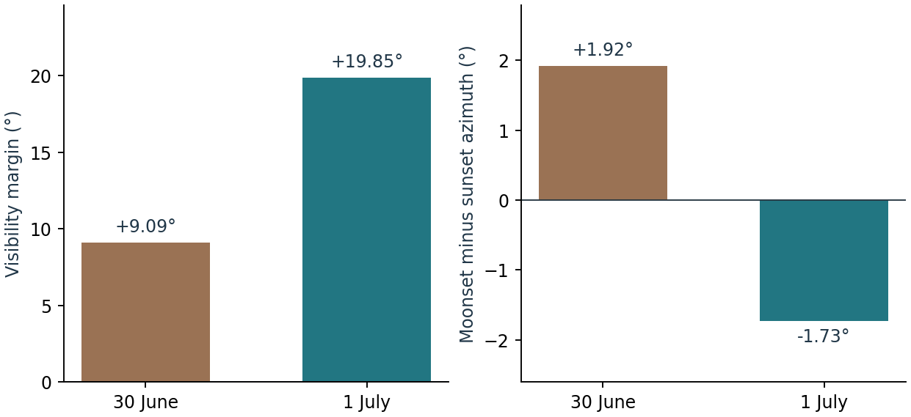

# Equinoctial full Moons and crescent crossovers {#sec-lunar-crossovers}

**Implementation.** skyscapeR 2.0.9004, `R/events.R` and `R/crescent-crossovers.R`. Silva & Pimenta (2012, §§2.1–2.2, figs. 3–4) defined families of observable events by comparing where the Moon and Sun rise or set across successive days and lunations. Their Alcyone Ephemeris 2.8 scripts recorded the first qualifying event for each year. skyscapeR implements the searches with Swiss Ephemeris, exposes the observing conventions, and can use a measured skyline [@silvapimenta2012; @sweprog]. A crossover is selected by the order of two **horizon bearings at their respective events**. The bodies need not be on the horizon together.

## Equinoctial full Moons {#crossover-efm}

[`EFM()`](fn-efm.html) searches chronological local civil dates from 60 days before to 65 days after the astronomical March or September equinox. It evaluates the illuminated fraction at the lunar centre crossing and requires at least `min.phase` (default 0.99). Let $D=A_{\mathrm{Moon}}-A_{\mathrm{Sun}}$, using topocentric bearings clockwise from true north. The 2.0.9004 EFM implementation applies the strict comparisons below to the two bearings directly.

| EFM | Moonrise condition | Moonset condition |
|---|---|---|
| Spring (March) | $D>0$ | $D<0$ |
| Autumn (September) | $D<0$ | $D>0$ |

The paper starts from a full Moon about two synodic months before the equinox and advances through days. The package makes its temporal bounds explicit in days and tests the phase at the lunar event itself.

On the rising branch, the solar comparator is the first sunrise on the lunar event's local date. On the setting branch, it is the **last sunset preceding moonset** among the first solar set events on the current and preceding local dates. A morning moonset will commonly be paired with the previous evening. Missing pairs are skipped. The function returns the first candidate passing both the illumination and bearing tests, and stops with the year and event if none qualifies. Changing the civil timezone can change the pairing. Changing the output declination frame leaves the topocentric selection rule in place.

**Worked moonset.** At 40° N, longitude 0°, elevation 400 m, the 2026 spring setting event occurred at **05:13:20 UTC on 1 April**. The preceding sunset was at **18:21:41 UTC on 31 March**. Lunar and solar azimuths were 266.6435° and 276.1790°, giving $D=-9.5356°$. At the reported lunar event the illuminated fraction was 0.991804. Both tests pass. Pairing this moonset with the evening of 1 April would use sunlight from an event that had yet to occur.

```r
skyscapeR.vars(dec = "geo", timezone = "UTC", calendar = "G",
               refraction = TRUE, atm = 1013.25, temp = 15)
EFM(2026, c(40, 0, 400), season = "spring", rise = FALSE)
```

The equinox anchors the search; it does not identify the nearest full Moon or require that the event fall after the equinox. The phase cutoff does not model twilight, extinction, atmospheric clarity or the appearance of the upper lunar limb.

## First and last crescents {#crossover-cc}

[`CC()`](fn-cc.html) first locates the relevant solstice and conjunctions. The initial lunation is **two conjunctions before the last conjunction at or before the solstice**. Its distance from the solstice depends on the Moon's phase at that solstice. This operationalises a starting window described in synodic months in the paper; a fixed subtraction of two mean synodic months need not start on the same lunation. Successive conjunctions are considered through 150 days after solstice.

For each conjunction the algorithm searches forwards for the first waxing evening or backwards for the last waning morning, up to eight civil days from the conjunction date. It assesses visibility at sunset for waxing crescents and at sunrise for waning crescents. In degrees, the adopted Caldwell–Laney margin is

$$M=h_{\mathrm{lower}}+E/3-11.3,$$

where $E$ is the **geocentric** Sun–Moon angular separation and $h_{\mathrm{lower}}$ is the **topocentric** lunar lower-limb altitude. The latter uses centre altitude and an angular radius calculated from instantaneous lunar distance and a physical radius of 1,737.4 km. Refraction affects the altitude when enabled. The rule requires $M\ge0$, elongation below 90°, and positive lower-limb clearance at the Moon's bearing. With a terrain profile, clearance is tested separately; the altitude used in $M$ remains referenced to the astronomical horizontal [@caldwell2001; @silvapimenta2012, §2.2].

The bearing comparison comes **after** that assessment. For a first crescent, compare sunset with the subsequent moonset; for a last crescent, compare sunrise with the preceding moonrise. The lunar crossing must be on the correct side of the solar event and within half a day. The shortest signed azimuth difference, Moon minus Sun, must be **negative for June** or **positive for December** in the package convention. The prose in §2.1 of the original paper describes the summer comparison using a greater-than relation. For reproduction, record the signs implemented here and the azimuth convention; copying the verbal inequality without its reference direction is ambiguous. The previous eligible difference is diagnostic. The current code requires the first eligible event on the specified side; it does not require an additional observed sign reversal from one lunation to the next.

**SIM1** tries only the first eligible evening or last eligible morning of each lunation. **SIM2** also tries the next evening or preceding morning. The base day takes precedence when both pass. If no lunation qualifies, CC returns missing event fields with a warning. Read `diagnostics` for the conjunction, assessment time, lower-limb altitude, elongation, margin, azimuth difference, day offset and number of qualifying lunations. Output declinations are geocentric; event selection uses topocentric bearings. The labels “summer” and “winter” retain their June and December meanings at southern sites.

## When a second evening changes the lunation {#crossover-example}

At the same site, search for the 2022 June **first crescent**. For the conjunction preceding 1 July, both evenings below passed the visibility criterion. The bearing order determined which evening qualified.

| Assessment evening (UTC) | Visibility margin | Moonset minus sunset azimuth | Decision |
|---|---:|---:|---|
| 30 June | +9.09° | +1.92° | Base evening: eligible crescent, wrong side for June. |
| 1 July | +19.85° | −1.73° | Additional evening: right side, eligible in SIM2. |

{fig-alt="At 40° north on 30 June and 1 July 2022 the respective crescent visibility margins are +9.09 and +19.85 degrees. The azimuth differences change from +1.92 to −1.73 degrees."}

SIM2 therefore returned **1 July**, whereas SIM1 returned **28 August**, with a margin of +3.98° and azimuth difference −4.49°. The extra evening changed which lunation met the definition. Describing SIM2 simply as a one-day uncertainty on the SIM1 date would miss this effect.

```r
site <- c(40, 0, 400)
CC(2022, site, season = "summer", crescent = "first", simulation = "SIM1")
CC(2022, site, season = "summer", crescent = "first", simulation = "SIM2")
```

## Comparison with the 2012 simulations {#crossover-archive}

The historical workbooks give annual solar and lunar declinations rather than event timestamps. Their coordinates can identify a likely neighbouring date or lunation, but cannot recover every setting in the original scripts. The comparison below concerns the archival 2.0 development analysis, 1620–2047, with a level horizon, longitude 0°, elevation 400 m, UTC, Gregorian dates, geocentric reported declinations, refraction on, 1013.25 mbar and 15 °C. These are the **reproduction settings**, not verified meteorological parameters of the original simulations.

| Comparison | Archived result | Scope |
|---|---|---|
| Spring and autumn EFM moonsets | At 0°, 60° N and 60° S, preceding-sunset pairing increased agreement within 0.02° lunar declination from 2,484 to **2,562 of 2,568**. | Five remaining choices were just above the 0.99 illumination boundary and one within about 0.002° of the azimuth boundary. |
| Four SIM1 crescent series | At the same three latitudes, **5,024 of 5,136** agreed within 0.02°. | No corresponding SIM2 accuracy follows from this count. A similar smoothed distribution can hide a wrong annual selection. |
| 40° N series | Additional systematic coordinate offsets remain. | Exploratory changes to the conversion altitude and timing reduced some residuals. The original settings are unresolved; this latitude is excluded from both counts above. |

Two individual records show how to read these comparisons. At the equator in autumn 1913, the archived EFM reconstruction selected a moonset with illumination **0.990003** and lunar declination **4.7246°**. The next morning's declination was **10.4302°**, matching the historical table's **10.43°**. The reproduced search accepts the earlier morning by about three millionths in illuminated fraction. The table supports the following-morning interpretation but does not tell us why the earlier date was skipped.

For the winter first crescent labelled 1708 at 60° N, the archived SIM1 run selected **12 January 1709**, whereas the source's pair of declinations matched **13 January**. The reconstructed base evening cleared the visibility threshold by only **0.019°**. The later date is inferred from both coordinates. Across the wider diagnostic sample, alternative search windows and solar-limb definitions recovered some discrepant cases but also changed previously matching controls. There is no established universal adjustment. Replay materials and archived diagnostics are provided separately: [worked examples](archives/crossovers-and-targets.zip) · [historical comparison and source-run records](archives/crossover-validation-record.zip).

The strength of the package implementation is access to the selected event pair, inputs, terrain and diagnostic margins. Agreement with historical simulation tables measures implementation agreement. Estimating the probability of real crescent detection requires observations independent of the rule used to select it.


**Related function entries**

[`EFM()`](fn-efm.html), [`CC()`](fn-cc.html), [`moonphase()`](fn-moonphase.html), [`riseset()`](fn-riseset.html), [`time2jd()`](fn-time2jd.html), [`jd2time()`](fn-jd2time.html), [`skyscapeR.vars()`](fn-skyscaper-vars.html).
