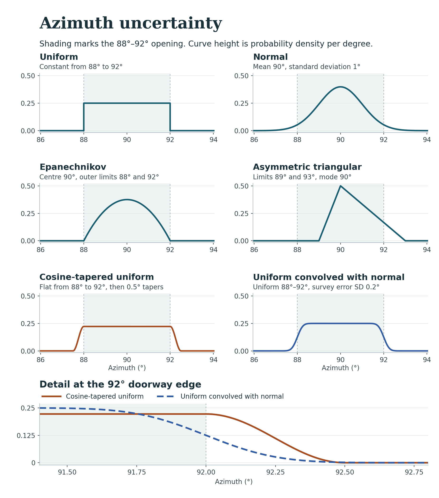
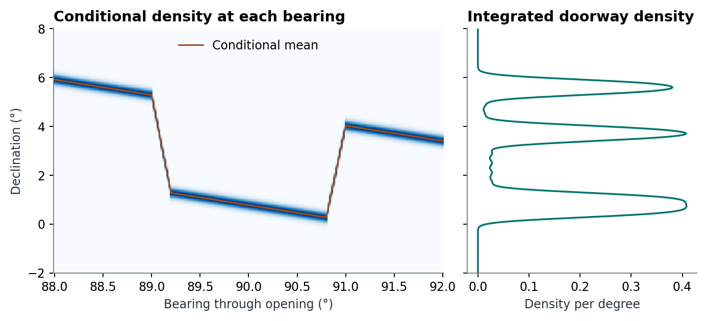
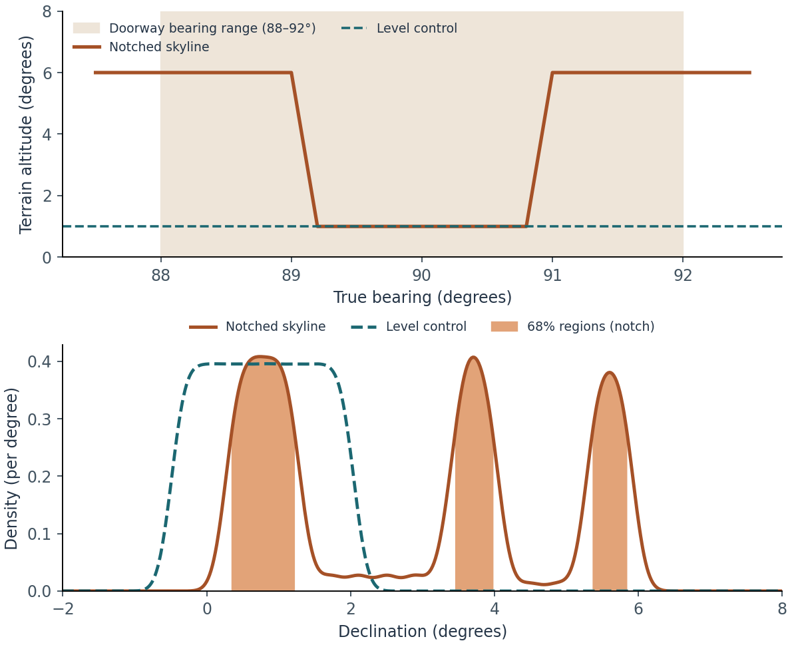

# From a measured orientation to a declination distribution {#sec-densities}

[Coverage of bearing densities on partial photographs](numerical-validation.qmd#h07-panorama-coverage).

**Implementation.** skyscapeR 2.0.9011, `R/measurement-density.R`, `R/statistics.R`, `R/dec-pdf.R`, `R/mechanics.R` and `R/misc.R`. A doorway admits a range of sightlines; each can meet a different altitude on the skyline. @silva2020 [§§2–3, figs. 1–5] represents uncertainty in the orientation as a probability density and transforms that density using the local horizon. The worked example follows one doorway from its measured angular opening to three distinct regions in declination.

[D01](numerical-validation.qmd#d01-density-checks) checks the input densities. [D02](numerical-validation.qmd#d02-bearing-propagation) compares the propagated density with independent integration and direct simulation on sloping, asymmetric and surveyed skylines. It documents grid-sensitive highest-density regions and the limits of the conditional Gaussian near the celestial pole.

## What does a measurement PDF represent? {#density-measurement}

Let $A$ denote true azimuth, increasing clockwise from north. The density $f_A(a)$ expresses how the analyst allocates support across the bearings consistent with the measurement. In Silva's framework the appropriate density depends on the measurement and the architecture [@silva2020, §2]. A directly observed axis with repeat readings can justify a concentrated density; an opening bounded by two jambs may justify a bounded interval. Assigning equal support throughout a doorway is an archaeological assumption. The PDF does not measure how often an original observer looked in each direction.

### Choosing the measurement model {#measurement-families}

All six [azimuth measurement models](function-methods.html#fn-az-pdf) express a judgement about the sightline as seen from a particular observing position. Suppose the measured edges of a doorway are 88° and 92°.

| Family | What the field evidence supports | Meaning of the arguments |
|:--|:--|:--|
| `normal` | Repeated readings or a calibrated error model support symmetric, approximately Gaussian error around one bearing. | `az=90, unc=1` sets a standard deviation of 1°. About 95.45% of the probability then lies between 88° and 92°. |
| `uniform` | The edges are firm limits and all sightlines inside are equally plausible. | `az=90, unc=2` defines the outer limits 88° and 92°. |
| `epanechnikov` | A central axis is preferred and the architecture bounds the view. | `az=90, unc=2` gives greatest density at 90° and a parabolic decline to zero at 88° and 92°. |
| `tapered_uniform` | The full opening deserves equal weight. Both recorded edges admit a finite margin. | `unc=2, taper=0.5` gives a flat 88°–92° core and a half-cosine taper to 87.5° and 92.5°. |
| `triangular` | The most plausible axis is identifiable. One side may be less securely reconstructed. | `az=90, lower=89, upper=93` gives a linear decline on each side, with a longer tail towards 93°. For a symmetric triangle, supply `unc` alone. |
| `uniform_normal` | The width of an equally weighted opening and an independent, zero-mean Gaussian error in its measured bearing can be estimated separately. | The survey-error SD defaults to 0.5°. An explicit `unc=2, survey.sd=0.2` rounds the profile inside and outside 88° and 92°. There is no finite outer cutoff in the underlying Gaussian error. |

{fig-alt="Six density curves and a detail of the two softened edges at 92 degrees."}

For a core half-width $w$ and a cosine taper of length $t$ on each side, the plateau has height $1/(2w+t)$ and the two shoulders together contain $t/(2w+t)$ of the probability. In this example, 11.1% lies outside the core. For the convolution, write the bearing as the sum of an equally weighted direction through the opening and an independent survey error. If $x$ is the offset from the centre, the unwrapped density is $[\Phi((x+w)/s)-\Phi((x-w)/s)]/(2w)$, where $s$ is the error standard deviation. With $s=0.2°$ the probability outside the nominal opening is about 4.0%. The taper stays level to the edge itself. The convolution has already fallen to approximately half its central height there.

Azimuth densities are periodic. A triangular interval from 358° to 3° can therefore have its mode at 0°. The grid samples [0°, 360°) at 0.01° by default. The cutoff of $10^{-5}$ is a density height applied after wrapping. Trimming tails leaves their mass out of the stored curve. Use a spacing fine enough to resolve both the opening and any narrow shoulders.

**[`dec.pdf()`](function-methods.html#fn-dec-pdf).** Use this route when the observation and its uncertainty already refer to declination. The physical support ends at ±90°, and the default cutoff is $10^{-4}$. A normal curve centred near a pole can therefore have less than unit area after clipping. A directly constructed declination density assigns its family in that coordinate. A normal azimuth density passed through terrain can yield a markedly different declination curve [@silva2020, §3].

## Point transformation and the conditional density {#density-transform}

For geometric altitude $h$, site latitude $\phi$ and true bearing $A$, the spherical relation is [@silva2020, eq. 1]

$$\sin\delta=\sin\phi\sin h+\cos\phi\cos h\cos A.$$

[`az2dec()`](function-methods.html#fn-az2dec) evaluates a single sightline using the inverse Swiss horizontal transformation, shifting the azimuth convention at the interface. With refraction enabled, the code adjusts altitude using observer elevation, pressure and temperature before the inverse transformation. It rounds returned declinations according to the input bearing representation. When reading a value off a measured skyline, distinguish the altitude of the terrain from an angular clearance above it. The inputs, atmosphere and precision must match before using an independent calculation as a comparator [@sweprog].

**[`coordtrans()`](function-methods.html#fn-coordtrans) implements the density transformation developed in Silva (2020).** The published idea is to marginalise over the plausible bearings, retaining the dependence of horizon altitude on bearing [@silva2020, §3, figs. 2–5]. In continuous notation,

$$f_\delta(d)=\int f_A(a)\,g(d\mid a)\,da.$$

For each sampled bearing, 2.0.9004 interpolates the profile height $H(a)$ and its altitude uncertainty $s_h(a)$. It transforms the two endpoint heights $H(a)\pm4s_h(a)$ to declinations $d_-$ and $d_+$. The conditional density $g$ is approximated by a normal with mean $(d_-+d_+)/2$ and standard deviation $|d_+-d_-|/8$. This preserves endpoint order reversals and allows the width to vary with the skyline. It is an endpoint-based approximation to a nonlinear mapping; the conditional mean need not equal the transform of $H(a)$. A zero transformed width raises an error because a Gaussian density with zero standard deviation is undefined in this computation. Artificially inflating the reported horizon error changes the model.

{fig-alt="A narrow conditional density follows a notch as bearing changes. Its integral has three declination modes."}

On a steep notch flank, even the geometric central track has a bearing derivative proportional to the skyline slope. Where $H$ is differentiable, in radians, $\cos\delta\,\mathrm d\delta/\mathrm dA=(\sin\phi\cos H-\cos\phi\sin H\cos A)H'(A)-\cos\phi\cos H\sin A$. At a corner the adjacent segments have different slopes. A single error propagated at the centre can consequently miss entire branches sampled by the opening. The numerical mixture accommodates those branches without dividing by a local derivative.

The implementation interpolates the conditional density values and azimuth weights onto an integration grid and sums their products with trapezoidal weights. Distinguish three numerical settings:

| Setting | Default | Controls |
|---|---:|---|
| `.prec` | 0.1° | Azimuth spacing used to integrate the conditional contributions. Bearings spanning north are unwrapped for continuity. |
| `.res` | 0.1° | Declination spacing at which the mixture is calculated. The upper calculation bound is added explicitly if necessary. |
| `.output.res` | 0.01° | Spacing of the returned declination curve, obtained by linear interpolation. More output coordinates alone cannot resolve a missed peak. |

Version 2.0.9004 uses linear interpolation, avoiding negative overshoot that could occur with a spline. It also explicitly treats distributions split across north. Each individual transformed PDF is normalised by its trapezoidal area on the returned grid. Transforming an already summed SPD does not perform that individual normalisation. In ideal continuous arithmetic, integration and summation commute for a common kernel. Site-specific skylines imply different kernels, while truncation and per-curve normalisation can also change finite-grid results. Supply horizons in observation order. Preserve the original azimuth curves and horizons for any later declination significance test.

## Worked example: a doorway across a notch {#density-notch}

At a synthetic site at 51° N, give the 88–92° doorway a uniform density. The terrain stands at 6° on either side and falls to 1° between bearings 89.2° and 90.8°, with 0.2°-wide sloping shoulders. Set horizon altitude uncertainty to 0.2° throughout and turn refraction off. A control uses the same doorway and uncertainty with a level 1° skyline. Only the terrain profile changes.

```r
site <- c(51, 0, 100)
notch <- createHor(c(0, 87, 89, 89.2, 90.8, 91, 93, 360),
                   c(6,  6,  6,    1,    1,  6,  6,   6),
                   loc = site, alt.unc = 0.2)
skyscapeR.vars(refraction = FALSE)
door <- az.pdf(90, unc = 2, pdf = "uniform")
d <- coordtrans(door, notch, xrange = c(-4, 9),
                .prec = 0.02, .res = 0.02, .output.res = 0.01)
total <- spd(d, xrange = c(-4, 9), normalise = TRUE)
hpdi(total, mass = 0.68)
```

{fig-alt="A two-panel figure compares a doorway spanning bearings 88 to 92 degrees on level and notched horizons. The level control has one broad peak, while the notched terrain produces three separated high-density regions."}

| Skyline | 68% highest-density regions in declination |
|---|---|
| Level at 1° | −0.08° to 1.64° |
| Notched | 0.35° to 1.21°, 3.46° to 3.97°, and 5.37° to 5.83° |

The central portion of the doorway faces the low notch. Its two flanks face higher terrain at different bearings, so they have different declinations even at the same terrain altitude. A conversion of only the centre and the two extremes loses this allocation of probability. Halving both calculation spacings from 0.02° to 0.01° gave the same reported interval endpoints to 0.01° in this example. This is a numerical sensitivity check on a constructed case, not field validation.

## Summation, highest-density regions and inference {#density-summary}

[`spd()`](function-methods.html#fn-spd) linearly interpolates each retained curve onto a common angular grid, assigns zero outside its support and sums the heights. With an automatically determined range, it zeroes summed heights below the cutoff. An explicit range retains the calculated heights within that range. With `normalise = TRUE`, it divides by the trapezoidal area over the *returned interval*. A narrow explicit range therefore conditions the displayed mass on the selected interval. Earlier builds normalised using a sum of sampled heights: on a regular grid with zero endpoint heights, the new heights are the old ones divided by grid spacing. Record normalisation when comparing figure ordinates across versions (see the versioned function help and package NEWS).

[`hpdi()`](function-methods.html#fn-hpdi) implements a discrete highest-density region [@hyndman1996]. On an equally spaced grid it sorts density heights and finds the level whose cumulative sum reaches the requested mass fraction, then includes all cells tied at that level. The result can include more than the nominal fraction. Separate connected runs give separate intervals; endpoints are grid coordinates. Gaps representing omitted cells are treated as zero mass, and regions spanning north are returned as two linear intervals. This is a description of concentration under the assumed measurement model. It does not test intentionality or reject a null hypothesis.

A strength of this workflow over a curve assembled by placing the same symmetric kernel at each converted central declination is that **the horizon can change the shape of each site's contribution**. Silva's worked comparison shows why curvigram and kernel-density peaks can shift relative to a terrain-aware SPD [@silva2020, fig. 5]. The price is sensitivity to the skyline, measurement model, endpoint approximation and numerical resolution. At limiting declinations or very small altitude uncertainties, check both grid convergence and the adequacy of the conditional Gaussian. A credible distribution still requires a defensible uncertainty model. The [significance chapter](significance.qmd) shows how these same curves enter simulations.

[Download the example scripts, inputs and outputs](archives/doorway-and-ridge-examples.zip). The archived package supplies the implementation; the example is reproducible separately from the validation studies.


## What the orientation displays calculate {#orientation-displays}

For an opening defined clockwise from left edge $A_L$ to right edge $A_R$, compute $w=(A_R-A_L)\bmod360°$ and centre $(A_L+w/2)\bmod360°$. An opening from 355° to 5° then has width 10° and centre 0°. Keep a common row order when selecting entrance records and site horizons. Passing $w/2$ to [`plotBars()`](function-methods.html#fn-plotbars) draws symmetric measurement limits. The default geometry is a line interval; explicitly supplying `shade` selects the bar default unless geometry is also specified. The unit labels the axis. Celestial bands require declination coordinates in this display. On a Cartesian azimuth axis an interval crossing north can extend below 0° or above 360°.

[`plotAzimuth()`](function-methods.html#fn-plotazimuth) draws bearings clockwise from north, with spokes or short rim marks. For each reference declination and target location it computes a diurnal track with [`orbit()`](function-methods.html#fn-orbit), interpolates altitude as a function of azimuth and solves for the zero-altitude roots on the eastern and western branches where bracketed. A two-epoch group contributes the stored boundary declinations. These compass marks assume a level horizon. The local terrain crossing for the same target can lie elsewhere. Inside/outside controls position the reference lines; labels remain outside. Repeated measured bearings can coincide.

The linked view of [`plot.skyscapeR.pdf()`](function-methods.html#fn-plot-skyscaper-pdf) requires one transformed index, the original azimuth PDF and a matching horizon or ordered horizon list. The panels connect the input distribution, azimuth-to-declination mapping and output density. A mass such as 0.68 can select disjoint intervals. Supplying just one of the source inputs is an error. The legacy `show.az` switch is ignored with a warning. A plain density plot needs neither source input. [`subset.skyscapeR.pdf()`](function-methods.html#fn-subset-skyscaper-pdf) uses the supplied R index on the list of curves and the name, azimuth, uncertainty and horizon metadata. It leaves other fields as stored. [`plot.skyscapeR.spd()`](function-methods.html#fn-plot-skyscaper-spd) draws the summed density, optionally with targets. A plotted peak carries no significance level by itself [@silva2020].

### Subsetting a directly constructed declination PDF {#subset-dec-centres}

Build 2.0.9006 retains the centre vector in the selected order, including empty and repeated selections. The [D01 rerun](numerical-validation.qmd#d01-density-checks) verifies the correction. For a [`dec.pdf()`](function-methods.html#fn-dec-pdf) object, 2.0.9004's [`subset.skyscapeR.pdf()`](function-methods.html#fn-subset-skyscaper-pdf) selects the requested curves, names and uncertainties but leaves `metadata$dec` unchanged. Given centres of −10° and +20° named A and B, `subset(x, 2)` returns B’s curve and uncertainty but retains both centres in the metadata. A reader who pairs the first retained curve with the first stored centre would assign it −10°. To retain a consistent centre vector, apply the selection to the input records and construct their PDF, or explicitly index the original centres with the same selection. The worked check is in `object-coverage.R` in the [photographic horizon examples](photographic-horizons.html#partial-photo-consumers).

**Related function entries**

[`az.pdf()`](function-methods.html#fn-az-pdf), [`dec.pdf()`](function-methods.html#fn-dec-pdf), [`az2dec()`](function-methods.html#fn-az2dec), [`coordtrans()`](function-methods.html#fn-coordtrans), [`spd()`](function-methods.html#fn-spd), [`hpdi()`](function-methods.html#fn-hpdi), [`createHor()`](function-methods.html#fn-createhor), [`skyscapeR.vars()`](function-methods.html#fn-skyscaper-vars), [`randomTest()`](function-methods.html#fn-randomtest), [`modelTest()`](function-methods.html#fn-modeltest).
