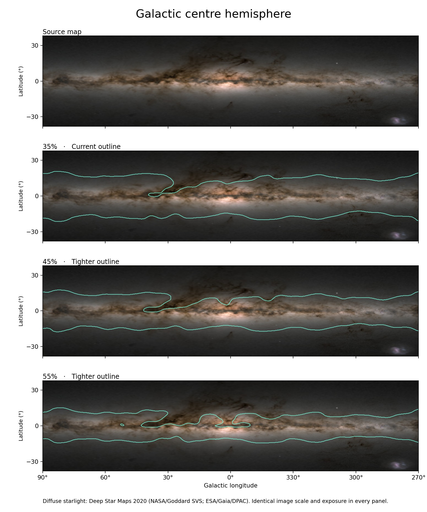
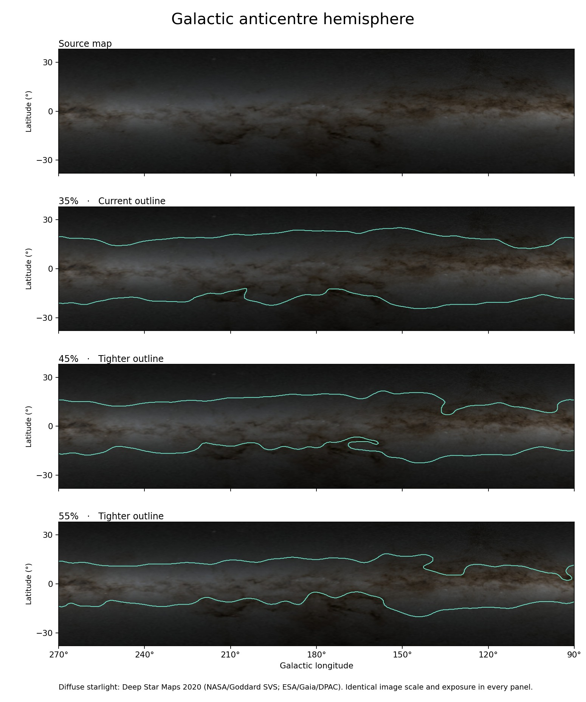

# Sky reconstruction and visual radiance {#sec-sketch}

**Implementation.** skyscapeR 2.0.9004, `R/sketchSky.R`, `R/light-budget.R` and `R/galactic.R`. A site reconstruction asks two distinct questions: where does a body appear relative to the skyline, and what light reaches the corresponding part of the sky? The plotting stage consumes their results. This distinction matters when a feature remains geometrically above the terrain but fades into the twilight background.

## Geometry and state {#meth-sketch}

[`sketchSky()`](function-methods.html#fn-sketchsky) takes a georeferenced horizon and an instant. Record the calendar and timezone when specifying civil time. It resolves astronomical positions at the site using the epoch-appropriate ephemeris and captures the session's refraction, pressure and temperature settings. The horizontal frame uses true azimuth clockwise from north. The resulting object can be replotted for another sector without moving the sky in time. Recompute the instant with [`skyStep()`](function-methods.html#fn-skystep) for a time sequence. See the ephemeris chapter for file coverage, time scales and the scope of the upstream precision claim.

Natural mode is the default. Stars, the Sun and the Moon are enabled by default; planets require their switch. The Milky Way switch follows the stars unless set explicitly. Turning the Moon off removes its disc and its illumination. A ridge occulting the disc in the plotted scene can still leave scattered moonlight. The [constellation geometry section](#sky-constellations) describes the endpoint selection.

## Linear radiance and the rendered pixel

A source of visual magnitude $m$ has relative flux $10^{-0.4m}$. For extinction coefficient $k$ in magnitudes per airmass, direct flux is attenuated by $10^{-0.4kX(h)}$, with $X(h)$ the Rozenberg airmass approximation used in the package [@schaefer1986; @krisciunas1991, eq. 14]. This uses altitude above the horizontal. It is the terrain that determines whether a rendered line of sight is blocked. Near the horizon, actual extinction is particularly sensitive to local conditions.

Stars remain unresolved as the field is enlarged. Planetary and lunar contributions use apparent size and illumination from Swiss Ephemeris. For a cluster with an integrated catalogue magnitude, the renderer subtracts light already assigned to plotted stars inside its projected footprint before distributing the residual glow. This avoids double-counting projected light; membership and individual detectability require different evidence [@crumey2014]. Source sizes and attributions are recorded in the package help and `inst/COPYRIGHTS`.

For a natural sketch, [`skyRadiance()`](function-methods.html#fn-skyradiance) samples the unmasked field as **magnitude-zero flux per square degree**. It returns total, direct-source and Milky Way matrices; subtracting the latter two from the total gives the atmospheric component. Pixel solid angle varies with altitude. For an azimuth width $\Delta A$ in radians and altitude limits $h_1,h_2$, its solid angle is $\Delta A(\sin h_2-\sin h_1)$ steradians. Convert to square degrees before multiplying the returned surface brightness by area and summing to recover source flux. The Sun's disc is drawn separately as an overlay.

The natural display combines the components before adapting to background brightness, compressing the brightness range and converting to screen colour. Directly comparing RGB values across zoom levels would mix photometry with pixel area and display mapping. The publication styles instead draw magnitude-scaled symbols. In 2.0 development the natural renderer adopted a shared light budget; historical experiments using the development-only model switch should be replayed with their archived source. The [study register](study-register.qmd) identifies the tested build for each result.

## Twilight and moonlight

The adopted zenith curve uses Paranal V-band photometry at solar depressions of 5–15°, with tabulated anchors and interpolation outside that interval [@patat2006]. Directional structure uses Sacramento Peak photometry [@koomen1952]. The implementation interpolates **log brightness ratios** across viewing altitudes and solar-altitude samples, then blends the solar and antisolar directions with weight $(1+\cos\Delta A)/2$. This yields a continuous azimuthal field that agrees at the zenith. The transition to the daytime gradient is a separate modelling choice. Moonlight uses the phase, altitude and angular scattering dependence in @krisciunas1991. Twilight colours remain illustrative; local aerosol and atmospheric structure are not reconstructed from the site coordinates [@lee1994; @lee2015].

## Milky Way boundary, internal structure and calibration

The outer envelope comes from a tracing of diffuse light in *Deep Star Maps 2020* [@deepstars]. Within it the package retains dark patches with at least 10% local contrast and uses brightness tiers at 1.10 and 1.75 times mean band tone after exclusion of dark patches. Retained patches cover at least 10 square degrees. These thresholds classify an image; they are not physiological visibility thresholds. For an alignment defined by the **outer boundary**, an enclosed dark patch remains inside the band. For visual reconstruction, the internal dark and bright structure matters and is displayed.

The implemented relative intensities are 0 outside the band, 1 for ordinary band, 0 for the dark class, and 1.35 and 2.1 for the two bright classes. These are provisional rendering weights. Atmospheric background can still contribute light in a dark-class pixel. The surface-brightness scale is anchored to a four-degree Carina field at 20.7 V mag arcsec⁻² [@kruit2024]. Normalisation in that field constrains the adopted scale, not every direction around the Galaxy. The direct atmospheric transmission is evaluated separately for the displayed altitude, so a geometrically predicted crossing can be difficult to follow near the skyline. A plotted Galactic equator and an outer Milky Way edge represent different sightlines.

### Reading the traced boundary

The tracing starts from the celestial-coordinate diffuse-light image in *Deep Star Maps 2020*, with bright foreground stars omitted [@deepstars]. On a 0.25° Galactic grid, the tracing script smooths image tone to 1° FWHM. At each longitude it estimates background tone from latitudes 35°–50° on either side of the plane and bright-band tone from the 90th percentile within 12° of the plane. Both longitude series are median-filtered over approximately 5°. For background $B$ and bright-band tone $P$, the selected contour level is $B+0.35(P-B)$. The algorithm keeps the main connected body across the longitude seam, fills enclosed holes, then smooths the envelope mask at 4° FWHM.

![The same Galactic directions appear in each row. The turquoise line traces the deployed outer envelope. The third row shows the five classes assigned by build 2.0.9004. The bottom row renders the intrinsic diffuse component on a common linear grey scale, using the package’s relative intensities 0, 1, 0, 1.35 and 2.1. Atmospheric attenuation and screen adaptation enter later. Dark lanes remain inside the outer edge even where their assigned diffuse flux is zero. Source map: Ernie Wright, NASA/Goddard SVS; ESA/Gaia/DPAC [@deepstars].](figures/milky-way-reconstruction.png){fig-alt="Centre and anticentre hemispheres in Galactic coordinates, each shown as diffuse starlight, the same map with its outer edge, the class grid and the intrinsic diffuse brightness."}

The anticentre band narrows at higher contrast cuts, but the same change also removes much of the extended bulge on the centre side. The adopted 35% cut preserves that structure using one rule around the full circumference. The 45% and 55% candidates below document the trade-off. The source image used to choose the edge cannot independently validate it.

Original centre and anticentre contrast comparisons

{fig-alt="Original centre comparison with the source map and three progressively tighter contours."}

{fig-alt="Original anticentre comparison with the source map and the same three contrast cuts."}

### How the Carina field fixes the intensity scale

The implementation in `R/light-budget.R` samples a circle of radius 2° centred at Galactic $(l,b)=(287°,-2°)$ on a 0.1° grid. Let $q_i$ be the relative intensity of the class at sample $i$. The mean $\bar q=\sum_i q_i\cos b_i/\sum_i\cos b_i$ accounts for the area represented by each Galactic latitude row. The intrinsic brightness assigned to class $j$, in magnitude-zero flux per square degree, is

$$B_j=q_j\,\frac{3600^2\,10^{-0.4\,(20.7)}}{\bar q}.$$

The factor $3600^2$ converts square arcseconds to square degrees. This construction makes the field mean reproduce the adopted Carina brightness [@kruit2024, table 3]. A comparison in the same field therefore checks the normalisation. Independent photometry elsewhere is needed to assess the extrapolation. In the renderer, the Galactic class is looked up along the geometrical direction corresponding to the displayed pixel, and its brightness is multiplied by transmission at the displayed altitude. This explains how the outline can retain the same geometrical extent while a low-altitude section loses visual contrast. The [study register](study-register.qmd) distinguishes the traced boundary, measured twilight comparisons, flux recovery and extinction checks.

## Constellation selection and planisphere geometry {#sky-constellations}

In [`sketchSky()`](function-methods.html#fn-sketchsky), a constellation selection can identify a set, a named figure, a stable identifier such as `CHN009`, or a table from [`importConstellations()`](function-methods.html#fn-importconstellations). Supplying the selection enables constellation lines unless the line switch is explicitly set. A legacy Stellarium FAB row gives one figure identifier, a segment count and two positive HIP identifiers per segment. The importer rejects malformed counts and duplicate figure IDs. It returns a reusable table of connections. The catalogue supplies the stellar positions. A magnitude cut on star symbols does not remove a valid line endpoint. A missing catalogue endpoint limits what can be drawn. The modern and Chinese mansion selections in the vignette can therefore be compared using exactly the same sky. For attribution use the source of the selected sky culture [@stellarium].

[`planisphere()`](function-methods.html#fn-planisphere) projects those connections on a different surface. With pole sign $p=+1$ in the northern hemisphere (including the equator), or $-1$ in the southern hemisphere, radius is $90°-p\delta$, plotted angle follows $p\alpha$, and the outer radius is $180°-|\phi|$. Between distinct endpoints the code samples the shorter great-circle arc at intervals of at most about 0.2°, then clips the projected line to the accessible sky. Coincident endpoints can denote a single marker. Optional equatorial, ecliptic and Galactic reference curves have distinct geometries. The observer's terrain profile, timestamp and atmospheric brightness do not enter this chart. Record the epoch, latitude, magnitude cut, figure set and enabled layers when comparing it to a dated sketch.

## Display styles, capture and stepping time {#sky-step-capture}

A natural [`sketchSky()`](function-methods.html#fn-sketchsky) uses enabled luminous sources and their atmospheric contributions. The publication-colour and publication-mono styles show positions with magnitude-scaled symbols. The catalogue filter `max.mag` acts before atmospheric dimming and leaves constellation endpoints, the Sun, Moon and planets outside that cut. In a natural sketch, turning the Sun or Moon off also removes its contribution to illumination. The stellar layer sets the default for the Milky Way unless `milky.way` is explicitly supplied. The ecliptic, celestial and Galactic equators, poles and zenith are independent guides.

[`stellariumSky()`](function-methods.html#fn-stellariumsky) freezes the external application's clock and captures a full-sphere Cylinder Fill raster. The seam is north, the centre south and the horizontal midline is zero altitude. A 30° crop of a 4096-pixel capture contains approximately 341 source pixels. Zooming into a saved raster cannot add stellar detail. Record Stellarium version, catalogue, selected sky culture and display switches. The capture defaults leave landscape and fog off. Other omitted switches can depend on the existing application state [@stellarium].

[`skyStep()`](function-methods.html#fn-skystep) computes $JD'=JD+\texttt{minutes}/1440$. For a native sketch it rebuilds the sky using its stored calendar, style, magnitude limit, extinction coefficient and display selection. It reads refraction, pressure and temperature again from the current session. For a Stellarium sky it requests another screenshot with the saved capture settings. In both cases assign the invisibly returned object before stepping again. Drawing another sector at the same instant only requires replotting. Doorway edge lines added to the graphics device must be redrawn after the new plot.

## Comparative strengths and outstanding issues

Stellarium provides an interactive planetarium with navigable sky, exchangeable sky cultures and landscape visualisation [@stellarium]. For an archaeological analysis, the specific advantage of skyscapeR is the ability to use the same R horizon and instant for the geometry, inspect the separate radiance components, and archive the inputs and calculation alongside the figure. No matched comparison in the register establishes photometric superiority over Stellarium. A screenshot can check gross appearance; validation of angular position, diffuse brightness or human detection requires a reference appropriate to that quantity.

The [study register](study-register.qmd#sky-rendering) reports the held-out twilight comparisons, the Sirius flux check and the differential extinction calculation. Independent measurements of the outer boundary and of surface brightness away from Carina remain outstanding.

**Related function entries**

[`body.position()`](function-methods.html#fn-body-position), [`createHor()`](function-methods.html#fn-createhor), [`importConstellations()`](function-methods.html#fn-importconstellations), [`plot.skyscapeR.horizon()`](function-methods.html#fn-plot-skyscaper-horizon), [`sketchSky()`](function-methods.html#fn-sketchsky), [`skyRadiance()`](function-methods.html#fn-skyradiance), [`skyscapeR.vars()`](function-methods.html#fn-skyscaper-vars), [`skyStep()`](function-methods.html#fn-skystep), [`star()`](function-methods.html#fn-star), [`stellariumSky()`](function-methods.html#fn-stellariumsky), [`time2jd()`](function-methods.html#fn-time2jd).
